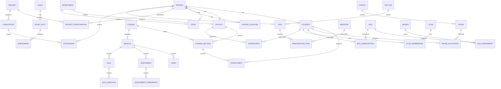

# University Healthcare and Research Management System (VIT)
## Comprehensive Case Study Solutions & System Architecture Specification

**Case Study – 4 | 50 Marks | MySQL implementation**

> **Source alignment:** This revised case study uses the user's original `Relational_Schema.txt`, actual `Inserted_Records.txt`, and corrected MySQL scripts. The SQL and sample results are documented, but have **not been verified by execution on a live MySQL instance**.

---

## Executive Summary & System Blueprint

The University Healthcare and Research Management System integrates academic administration, people and departments, research projects and publications, library circulation, hostels, healthcare visits, transport, clubs, online learning, and faculty mentoring in one relational database. The implementation targets **MySQL**, using the database name `university_management`. The schema contains **41 distinct tables**. Primary keys, composite keys, foreign keys, and junction tables model relationships among the subsystems. No PostgreSQL compatibility, automatic fine-calculation trigger, or BCNF compliance is claimed without separate testing or proof.

### System Scope & Subsystems

1. **Identity and human resources:** `PERSON`, `STUDENT`, `FACULTY`, `STAFF`, `VISITING_SCHOLAR`, `DEPARTMENT`.
2. **Academic management:** `COURSE`, `COURSE_SECTION`, `ENROLLMENT`.
3. **Research and publications:** `PROJECT`, `PROJECT_PARTICIPATION`, `PUBLICATION`, `AUTHORSHIP`.
4. **Library:** `BOOK`, `BOOK_COPY`, `BORROWING`.
5. **Hostel:** `HOSTEL`, `ROOM`, `ROOM_ALLOCATION`.
6. **Healthcare:** `DOCTOR`, `MEDICINE`, `VISIT`, `PRESCRIPTION_ITEM`.
7. **Transportation:** `DRIVER`, `BUS`, `BUS_ASSIGNMENT`, `BUS_SUBSCRIPTION`.
8. **Clubs:** `CLUB`, `CLUB_MEMBERSHIP`.
9. **Learning management:** `MODULE`, `VIDEO`, `ASSIGNMENT`, `QUIZ`, `QUIZ_QUESTION`, `ASSIGNMENT_SUBMISSION`.
10. **Mentoring and additional attributes:** `MENTORING`, `SUPERVISION`, `FACULTY_PHONE`, `FACULTY_RESEARCH_INTEREST`, `STUDENT_SKILL`, `STUDENT_CERTIFICATION`.

---

## Question 1: Comprehensive Entity-Relationship (E-R) Modeling (10 Marks)

### 1.1 Semantic E-R Design Specifications

**Superclass and roles.** `PERSON` holds `Person_ID`, name components (`First_Name`, `Middle_Name`, `Last_Name`), `Date_of_Birth`, `Gender`, `Phone`, `Email`, and address components. `STUDENT`, `FACULTY`, `STAFF`, and `VISITING_SCHOLAR` use `Person_ID` as both primary key and foreign key to `PERSON`, allowing the same person to hold more than one role. `STUDENT.Roll_No` and `FACULTY.Employee_ID` are unique identifiers but **not** their respective primary keys.

**Department and academic relationships.** `FACULTY.Dept_ID` and `STAFF.Dept_ID` reference `DEPARTMENT`; `DEPARTMENT.HOD_Faculty_ID` references `FACULTY.Person_ID`. A `COURSE` can have several `COURSE_SECTION` offerings, identified by `(Course_ID, Semester, Academic_Year, Section_No)`. `ENROLLMENT` links a student to one specific course offering and stores grade, enrollment date, and attendance.

**Research.** `PROJECT_PARTICIPATION` connects people to projects with role, joining date, and contribution percentage. `PUBLICATION` refers to its research project, while `AUTHORSHIP` connects individual people to publications and records author order. These are separate relationships: a project participant is not automatically an author.

**Other operational relationships.** `BOOK_COPY` depends on `BOOK`; `BORROWING` records use of a physical copy. `ROOM` depends on `HOSTEL`, and `ROOM_ALLOCATION` associates students with rooms over time. `VISIT` connects a patient to a doctor; `PRESCRIPTION_ITEM` records medicines for a visit. Bus assignments, bus subscriptions, club memberships, mentoring, and supervision are also modeled as relationships or associative tables.

**Composite and multivalued attributes.** Name and address are decomposed into columns in `PERSON`. `FACULTY_PHONE`, `FACULTY_RESEARCH_INTEREST`, `STUDENT_SKILL`, and `STUDENT_CERTIFICATION` represent multivalued attributes in separate tables. Age and experience can be calculated from dates, but the supplied MySQL schema does not implement dedicated calculation views.

**Identifying/composite-key examples.** `COURSE_SECTION` (`Course_ID`, `Semester`, `Academic_Year`, `Section_No`), `BOOK_COPY` (`ISBN`, `Copy_No`), `ROOM` (`Hostel_ID`, `Room_No`), `QUIZ_QUESTION` (`Quiz_ID`, `Question_No`), and `ASSIGNMENT_SUBMISSION` (`Assignment_ID`, `Submission_No`) have composite keys. Their weak-entity classification should be interpreted according to the actual ER model; composite keys alone do not prove weak-entity status.

### 1.2 E-R Diagram (Mermaid Overview)

The diagram is a **high-level relationship overview**, not a substitute for the full 41-table schema. It uses the implemented table names and key references.



---

## Question 2: Relational Schema Conversion (10 Marks)

### 2.1 Mapping Rules

1. **Strong entities** become relations with their own primary keys (for example, `PERSON`, `DEPARTMENT`, `PROJECT`).
2. **Superclass/subclass mapping** uses one `PERSON` relation plus role relations keyed by the same `Person_ID`. This supports overlapping roles without copying the personal attributes.
3. **One-to-many relationships** place the parent key as a foreign key on the many side, such as `FACULTY.Dept_ID`.
4. **Many-to-many relationships** become associative relations, such as `PROJECT_PARTICIPATION` and `AUTHORSHIP`.
5. **Multivalued attributes** are represented by their own relations (`STUDENT_SKILL`, `FACULTY_PHONE`, etc.).
6. **Dependent/composite-key entities** include the parent's identifying key in a composite primary key where appropriate (`BOOK_COPY`, `ROOM`, `COURSE_SECTION`).
7. **Derived values** such as age and experience can be calculated when needed; they are not stored in the supplied base tables.

### 2.2 Formal Relational Schema Inventory (41 Relations)

This inventory is extracted from the supplied corrected schema. `PK` denotes the declared primary key. For the exact foreign-key constraints, refer to the full DDL in Question 3.

| No. | Relation | PK | Columns |
|---:|---|---|---|

| 1 | `PERSON` | `Person_ID` | `Person_ID`, `First_Name`, `Middle_Name`, `Last_Name`, `Date_of_Birth`, `Gender`, `Phone`, `Email`, `Door_No`, `Street`, `City`, `State`, `Country`, `Postal_Code` |
| 2 | `STUDENT` | `Person_ID` | `Person_ID`, `Roll_No`, `Program`, `Semester`, `CGPA` |
| 3 | `FACULTY` | `Person_ID` | `Person_ID`, `Employee_ID`, `Designation`, `Salary`, `Joining_Date`, `Dept_ID` |
| 4 | `STAFF` | `Person_ID` | `Person_ID`, `Shift`, `Dept_ID` |
| 5 | `VISITING_SCHOLAR` | `Person_ID` | `Person_ID`, `Home_University`, `Country`, `Visit_Duration` |
| 6 | `DEPARTMENT` | `Dept_ID` | `Dept_ID`, `Name`, `Building`, `Budget`, `HOD_Faculty_ID` |
| 7 | `COURSE` | `Course_ID` | `Course_ID`, `Title`, `Credits` |
| 8 | `COURSE_SECTION` | `Course_ID + Semester + Academic_Year + Section_No` | `Course_ID`, `Semester`, `Academic_Year`, `Section_No`, `Faculty_ID` |
| 9 | `ENROLLMENT` | `Student_ID + Course_ID + Semester + Academic_Year + Section_No` | `Student_ID`, `Course_ID`, `Semester`, `Academic_Year`, `Section_No`, `Enrollment_Date`, `Grade`, `Attendance_Pct` |
| 10 | `PROJECT` | `Project_ID` | `Project_ID`, `Title`, `Budget`, `Start_Date`, `End_Date` |
| 11 | `PROJECT_PARTICIPATION` | `Person_ID + Project_ID` | `Person_ID`, `Project_ID`, `Role`, `Joining_Date`, `Contribution_Pct` |
| 12 | `PUBLICATION` | `DOI` | `DOI`, `Title`, `Publication_Date`, `Venue_Details`, `Project_ID` |
| 13 | `AUTHORSHIP` | `Person_ID + DOI` | `Person_ID`, `DOI`, `Author_Order` |
| 14 | `BOOK` | `ISBN` | `ISBN`, `Title`, `Edition`, `Publisher` |
| 15 | `BOOK_COPY` | `ISBN + Copy_No` | `ISBN`, `Copy_No`, `Rack_Location`, `Status` |
| 16 | `BORROWING` | `Person_ID + ISBN + Copy_No + Issue_Date` | `Person_ID`, `ISBN`, `Copy_No`, `Issue_Date`, `Due_Date`, `Return_Date`, `Fine_Amount` |
| 17 | `HOSTEL` | `Hostel_ID` | `Hostel_ID`, `Name`, `Hostel_Type` |
| 18 | `ROOM` | `Hostel_ID + Room_No` | `Hostel_ID`, `Room_No`, `Capacity` |
| 19 | `ROOM_ALLOCATION` | `Student_ID + Hostel_ID + Room_No + Check_In_Date` | `Student_ID`, `Hostel_ID`, `Room_No`, `Check_In_Date`, `Check_Out_Date` |
| 20 | `DOCTOR` | `Doctor_ID` | `Doctor_ID` |
| 21 | `MEDICINE` | `Medicine_ID` | `Medicine_ID` |
| 22 | `VISIT` | `Patient_ID + Doctor_ID + Visit_Date` | `Patient_ID`, `Doctor_ID`, `Visit_Date`, `Diagnosis`, `Prescription` |
| 23 | `PRESCRIPTION_ITEM` | `Patient_ID + Doctor_ID + Visit_Date + Medicine_ID` | `Patient_ID`, `Doctor_ID`, `Visit_Date`, `Medicine_ID`, `Dosage` |
| 24 | `DRIVER` | `Driver_ID` | `Driver_ID` |
| 25 | `BUS` | `Bus_ID` | `Bus_ID`, `Route_No`, `Seating_Capacity` |
| 26 | `BUS_ASSIGNMENT` | `Driver_ID + Bus_ID + Assignment_Date + Shift` | `Driver_ID`, `Bus_ID`, `Assignment_Date`, `Shift` |
| 27 | `BUS_SUBSCRIPTION` | `Student_ID + Bus_ID` | `Student_ID`, `Bus_ID`, `Subscription_Date`, `Fee_Paid` |
| 28 | `CLUB` | `Club_ID` | `Club_ID`, `Name`, `Faculty_Advisor_ID` |
| 29 | `CLUB_MEMBERSHIP` | `Student_ID + Club_ID` | `Student_ID`, `Club_ID`, `Joining_Date`, `Position`, `Duration` |
| 30 | `MODULE` | `Module_ID` | `Module_ID`, `Course_ID` |
| 31 | `VIDEO` | `Video_ID` | `Video_ID`, `Module_ID` |
| 32 | `ASSIGNMENT` | `Assignment_ID` | `Assignment_ID`, `Module_ID` |
| 33 | `QUIZ` | `Quiz_ID` | `Quiz_ID`, `Module_ID` |
| 34 | `QUIZ_QUESTION` | `Quiz_ID + Question_No` | `Quiz_ID`, `Question_No` |
| 35 | `ASSIGNMENT_SUBMISSION` | `Assignment_ID + Submission_No` | `Assignment_ID`, `Submission_No`, `Student_ID`, `Submission_Time`, `Marks`, `Feedback` |
| 36 | `MENTORING` | `Mentor_ID + Mentee_ID` | `Mentor_ID`, `Mentee_ID`, `Start_Date` |
| 37 | `SUPERVISION` | `Faculty_ID + Student_ID` | `Faculty_ID`, `Student_ID`, `Research_Area` |
| 38 | `FACULTY_PHONE` | `Faculty_ID + Phone_Number` | `Faculty_ID`, `Phone_Number` |
| 39 | `FACULTY_RESEARCH_INTEREST` | `Faculty_ID + Research_Interest` | `Faculty_ID`, `Research_Interest` |
| 40 | `STUDENT_SKILL` | `Student_ID + Skill` | `Student_ID`, `Skill` |
| 41 | `STUDENT_CERTIFICATION` | `Student_ID + Certification` | `Student_ID`, `Certification` |

### 2.3 Normalization Discussion

The design separates personal details from role-specific details, avoids repeating multiple skills or phone numbers in a single cell, and represents many-to-many relationships through junction tables. These are consistent with the objectives of 1NF and reducing update anomalies. However, the supplied files do **not** include a complete functional-dependency analysis for every table. Therefore, a blanket claim that all 41 tables have been formally proven to satisfy 3NF or BCNF is not made here. For formal grading, functional dependencies and candidate keys should be checked relation by relation.

---

## Question 3: Relational Implementation (SQL DDL & Data Population) (10 Marks)

### 3.1 MySQL DDL Script

The following is the supplied `schema_corrected.sql`, reproduced in full to make the report self-contained. It creates `university_management` and the 41 tables, and does not contain destructive `DROP TABLE` statements. **Run it only against a fresh database** to avoid table-already-exists errors.

```sql
-- University Healthcare and Research Management System
-- MySQL schema aligned with original relational schema and insertion records.
-- Execute on a fresh database; no DROP statements are included.

CREATE DATABASE IF NOT EXISTS university_management;
USE university_management;
CREATE TABLE PERSON (
    Person_ID INT PRIMARY KEY,
    First_Name VARCHAR(50) NOT NULL,
    Middle_Name VARCHAR(50),
    Last_Name VARCHAR(50) NOT NULL,
    Date_of_Birth DATE,
    Gender VARCHAR(20),
    Phone VARCHAR(15),
    Email VARCHAR(100),
    Door_No VARCHAR(20),
    Street VARCHAR(100),
    City VARCHAR(50),
    State VARCHAR(50),
    Country VARCHAR(50),
    Postal_Code VARCHAR(10)
);
CREATE TABLE STUDENT (
    Person_ID INT PRIMARY KEY,
    Roll_No VARCHAR(20) UNIQUE NOT NULL,
    Program VARCHAR(100),
    Semester INT,
    CGPA DECIMAL(3,2),

    FOREIGN KEY (Person_ID)
        REFERENCES PERSON(Person_ID)
);
CREATE TABLE FACULTY (
    Person_ID INT PRIMARY KEY,
    Employee_ID VARCHAR(20) UNIQUE NOT NULL,
    Designation VARCHAR(100),
    Salary DECIMAL(12,2),
    Joining_Date DATE,
    Dept_ID INT,

    FOREIGN KEY (Person_ID)
        REFERENCES PERSON(Person_ID)
);
CREATE TABLE STAFF (
    Person_ID INT PRIMARY KEY,
    Shift VARCHAR(30),
    Dept_ID INT,

    FOREIGN KEY (Person_ID)
        REFERENCES PERSON(Person_ID)
);
CREATE TABLE VISITING_SCHOLAR (
    Person_ID INT PRIMARY KEY,
    Home_University VARCHAR(150),
    Country VARCHAR(50),
    Visit_Duration VARCHAR(50),

    FOREIGN KEY (Person_ID)
        REFERENCES PERSON(Person_ID)
);
CREATE TABLE DEPARTMENT (
    Dept_ID INT PRIMARY KEY,
    Name VARCHAR(100) NOT NULL,
    Building VARCHAR(100),
    Budget DECIMAL(15,2),
    HOD_Faculty_ID INT UNIQUE
);
ALTER TABLE FACULTY
ADD CONSTRAINT fk_faculty_department
FOREIGN KEY (Dept_ID)
REFERENCES DEPARTMENT(Dept_ID);

ALTER TABLE STAFF
ADD CONSTRAINT fk_staff_department
FOREIGN KEY (Dept_ID)
REFERENCES DEPARTMENT(Dept_ID);

ALTER TABLE DEPARTMENT
ADD CONSTRAINT fk_department_hod
FOREIGN KEY (HOD_Faculty_ID)
REFERENCES FACULTY(Person_ID);

CREATE TABLE COURSE (
    Course_ID INT PRIMARY KEY,
    Title VARCHAR(150) NOT NULL,
    Credits INT
);
CREATE TABLE COURSE_SECTION (
    Course_ID INT,
    Semester VARCHAR(20),
    Academic_Year VARCHAR(20),
    Section_No VARCHAR(10),
    Faculty_ID INT,

    PRIMARY KEY (
        Course_ID,
        Semester,
        Academic_Year,
        Section_No
    ),

    FOREIGN KEY (Course_ID)
        REFERENCES COURSE(Course_ID),

    FOREIGN KEY (Faculty_ID)
        REFERENCES FACULTY(Person_ID)
);
CREATE TABLE ENROLLMENT (
    Student_ID INT,
    Course_ID INT,
    Semester VARCHAR(20),
    Academic_Year VARCHAR(20),
    Section_No VARCHAR(10),
    Enrollment_Date DATE,
    Grade VARCHAR(5),
    Attendance_Pct DECIMAL(5,2),

    PRIMARY KEY (
        Student_ID,
        Course_ID,
        Semester,
        Academic_Year,
        Section_No
    ),

    FOREIGN KEY (Student_ID)
        REFERENCES STUDENT(Person_ID),

    FOREIGN KEY (
        Course_ID,
        Semester,
        Academic_Year,
        Section_No
    )
        REFERENCES COURSE_SECTION(
            Course_ID,
            Semester,
            Academic_Year,
            Section_No
        )
);
CREATE TABLE PROJECT (
    Project_ID INT PRIMARY KEY,
    Title VARCHAR(200),
    Budget DECIMAL(15,2),
    Start_Date DATE,
    End_Date DATE
);
CREATE TABLE PROJECT_PARTICIPATION (
    Person_ID INT,
    Project_ID INT,
    Role VARCHAR(100),
    Joining_Date DATE,
    Contribution_Pct DECIMAL(5,2),

    PRIMARY KEY (Person_ID, Project_ID),

    FOREIGN KEY (Person_ID)
        REFERENCES PERSON(Person_ID),

    FOREIGN KEY (Project_ID)
        REFERENCES PROJECT(Project_ID)
);
CREATE TABLE PUBLICATION (
    DOI VARCHAR(100) PRIMARY KEY,
    Title VARCHAR(250),
    Publication_Date DATE,
    Venue_Details VARCHAR(250),
    Project_ID INT,

    FOREIGN KEY (Project_ID)
        REFERENCES PROJECT(Project_ID)
);
CREATE TABLE AUTHORSHIP (
    Person_ID INT,
    DOI VARCHAR(100),
    Author_Order INT,

    PRIMARY KEY (Person_ID, DOI),

    FOREIGN KEY (Person_ID)
        REFERENCES PERSON(Person_ID),

    FOREIGN KEY (DOI)
        REFERENCES PUBLICATION(DOI)
);
CREATE TABLE BOOK (
    ISBN VARCHAR(20) PRIMARY KEY,
    Title VARCHAR(200),
    Edition VARCHAR(50),
    Publisher VARCHAR(150)
);
CREATE TABLE BOOK_COPY (
    ISBN VARCHAR(20),
    Copy_No INT,
    Rack_Location VARCHAR(50),
    Status VARCHAR(30),

    PRIMARY KEY (ISBN, Copy_No),

    FOREIGN KEY (ISBN)
        REFERENCES BOOK(ISBN)
);
CREATE TABLE BORROWING (
    Person_ID INT,
    ISBN VARCHAR(20),
    Copy_No INT,
    Issue_Date DATE,
    Due_Date DATE,
    Return_Date DATE,
    Fine_Amount DECIMAL(10,2),

    PRIMARY KEY (
        Person_ID,
        ISBN,
        Copy_No,
        Issue_Date
    ),

    FOREIGN KEY (Person_ID)
        REFERENCES PERSON(Person_ID),

    FOREIGN KEY (ISBN, Copy_No)
        REFERENCES BOOK_COPY(ISBN, Copy_No)
);
CREATE TABLE HOSTEL (
    Hostel_ID INT PRIMARY KEY,
    Name VARCHAR(100),
    Hostel_Type VARCHAR(50)
);
CREATE TABLE ROOM (
    Hostel_ID INT,
    Room_No VARCHAR(20),
    Capacity INT,

    PRIMARY KEY (Hostel_ID, Room_No),

    FOREIGN KEY (Hostel_ID)
        REFERENCES HOSTEL(Hostel_ID)
);
CREATE TABLE ROOM_ALLOCATION (
    Student_ID INT,
    Hostel_ID INT,
    Room_No VARCHAR(20),
    Check_In_Date DATE,
    Check_Out_Date DATE,

    PRIMARY KEY (
        Student_ID,
        Hostel_ID,
        Room_No,
        Check_In_Date
    ),

    FOREIGN KEY (Student_ID)
        REFERENCES STUDENT(Person_ID),

    FOREIGN KEY (Hostel_ID, Room_No)
        REFERENCES ROOM(Hostel_ID, Room_No)
);
CREATE TABLE DOCTOR (
    Doctor_ID INT PRIMARY KEY
);
CREATE TABLE MEDICINE (
    Medicine_ID INT PRIMARY KEY
);
CREATE TABLE VISIT (
    Patient_ID INT,
    Doctor_ID INT,
    Visit_Date DATE,
    Diagnosis VARCHAR(250),
    Prescription VARCHAR(500),

    PRIMARY KEY (
        Patient_ID,
        Doctor_ID,
        Visit_Date
    ),

    FOREIGN KEY (Patient_ID)
        REFERENCES PERSON(Person_ID),

    FOREIGN KEY (Doctor_ID)
        REFERENCES DOCTOR(Doctor_ID)
);
CREATE TABLE PRESCRIPTION_ITEM (
    Patient_ID INT,
    Doctor_ID INT,
    Visit_Date DATE,
    Medicine_ID INT,
    Dosage VARCHAR(100),

    PRIMARY KEY (
        Patient_ID,
        Doctor_ID,
        Visit_Date,
        Medicine_ID
    ),

    FOREIGN KEY (
        Patient_ID,
        Doctor_ID,
        Visit_Date
    )
        REFERENCES VISIT(
            Patient_ID,
            Doctor_ID,
            Visit_Date
        ),

    FOREIGN KEY (Medicine_ID)
        REFERENCES MEDICINE(Medicine_ID)
);
CREATE TABLE DRIVER (
    Driver_ID INT PRIMARY KEY
);
CREATE TABLE BUS (
    Bus_ID INT PRIMARY KEY,
    Route_No VARCHAR(20),
    Seating_Capacity INT
);
CREATE TABLE BUS_ASSIGNMENT (
    Driver_ID INT,
    Bus_ID INT,
    Assignment_Date DATE,
    Shift VARCHAR(30),

    PRIMARY KEY (
        Driver_ID,
        Bus_ID,
        Assignment_Date,
        Shift
    ),

    FOREIGN KEY (Driver_ID)
        REFERENCES DRIVER(Driver_ID),

    FOREIGN KEY (Bus_ID)
        REFERENCES BUS(Bus_ID)
);
CREATE TABLE BUS_SUBSCRIPTION (
    Student_ID INT,
    Bus_ID INT,
    Subscription_Date DATE,
    Fee_Paid DECIMAL(10,2),

    PRIMARY KEY (Student_ID, Bus_ID),

    FOREIGN KEY (Student_ID)
        REFERENCES STUDENT(Person_ID),

    FOREIGN KEY (Bus_ID)
        REFERENCES BUS(Bus_ID)
);
CREATE TABLE CLUB (
    Club_ID INT PRIMARY KEY,
    Name VARCHAR(100),
    Faculty_Advisor_ID INT,

    FOREIGN KEY (Faculty_Advisor_ID)
        REFERENCES FACULTY(Person_ID)
);

CREATE TABLE CLUB_MEMBERSHIP (
    Student_ID INT,
    Club_ID INT,
    Joining_Date DATE,
    Position VARCHAR(30),
    Duration VARCHAR(50),

    PRIMARY KEY (Student_ID, Club_ID),

    FOREIGN KEY (Student_ID)
        REFERENCES STUDENT(Person_ID),

    FOREIGN KEY (Club_ID)
        REFERENCES CLUB(Club_ID)
);
CREATE TABLE MODULE (
    Module_ID INT PRIMARY KEY,
    Course_ID INT,

    FOREIGN KEY (Course_ID)
        REFERENCES COURSE(Course_ID)
);
CREATE TABLE VIDEO (
    Video_ID INT PRIMARY KEY,
    Module_ID INT,

    FOREIGN KEY (Module_ID)
        REFERENCES MODULE(Module_ID)
);
CREATE TABLE ASSIGNMENT (
    Assignment_ID INT PRIMARY KEY,
    Module_ID INT,

    FOREIGN KEY (Module_ID)
        REFERENCES MODULE(Module_ID)
);
CREATE TABLE QUIZ (
    Quiz_ID INT PRIMARY KEY,
    Module_ID INT,

    FOREIGN KEY (Module_ID)
        REFERENCES MODULE(Module_ID)
);
CREATE TABLE QUIZ_QUESTION (
    Quiz_ID INT,
    Question_No INT,

    PRIMARY KEY (Quiz_ID, Question_No),

    FOREIGN KEY (Quiz_ID)
        REFERENCES QUIZ(Quiz_ID)
);
CREATE TABLE ASSIGNMENT_SUBMISSION (
    Assignment_ID INT,
    Submission_No INT,
    Student_ID INT,
    Submission_Time DATETIME,
    Marks DECIMAL(5,2),
    Feedback VARCHAR(500),

    PRIMARY KEY (
        Assignment_ID,
        Submission_No
    ),

    FOREIGN KEY (Assignment_ID)
        REFERENCES ASSIGNMENT(Assignment_ID),

    FOREIGN KEY (Student_ID)
        REFERENCES STUDENT(Person_ID)
);
CREATE TABLE MENTORING (
    Mentor_ID INT,
    Mentee_ID INT,
    Start_Date DATE,

    PRIMARY KEY (Mentor_ID, Mentee_ID),

    FOREIGN KEY (Mentor_ID)
        REFERENCES FACULTY(Person_ID),

    FOREIGN KEY (Mentee_ID)
        REFERENCES FACULTY(Person_ID)
);
CREATE TABLE SUPERVISION (
    Faculty_ID INT,
    Student_ID INT,
    Research_Area VARCHAR(200),

    PRIMARY KEY (Faculty_ID, Student_ID),

    FOREIGN KEY (Faculty_ID)
        REFERENCES FACULTY(Person_ID),

    FOREIGN KEY (Student_ID)
        REFERENCES STUDENT(Person_ID)
);
CREATE TABLE FACULTY_PHONE (
    Faculty_ID INT,
    Phone_Number VARCHAR(15),

    PRIMARY KEY (Faculty_ID, Phone_Number),

    FOREIGN KEY (Faculty_ID)
        REFERENCES FACULTY(Person_ID)
);
CREATE TABLE FACULTY_RESEARCH_INTEREST (
    Faculty_ID INT,
    Research_Interest VARCHAR(150),

    PRIMARY KEY (Faculty_ID, Research_Interest),

    FOREIGN KEY (Faculty_ID)
        REFERENCES FACULTY(Person_ID)
);
CREATE TABLE STUDENT_SKILL (
    Student_ID INT,
    Skill VARCHAR(100),

    PRIMARY KEY (Student_ID, Skill),

    FOREIGN KEY (Student_ID)
        REFERENCES STUDENT(Person_ID)
);
CREATE TABLE STUDENT_CERTIFICATION (
    Student_ID INT,
    Certification VARCHAR(150),

    PRIMARY KEY (Student_ID, Certification),

    FOREIGN KEY (Student_ID)
        REFERENCES STUDENT(Person_ID)
);
```

### 3.2 MySQL Data Insertion (DML)

The following is the actual dataset aligned with the original inserted records. It contains **41 INSERT statements** and department HoD updates. Sample data is illustrative, not a claim about real VIT individuals. Do not rerun these inserts against an already populated database, as primary-key conflicts can occur.

```sql
-- UNIVERSITY HEALTHCARE AND RESEARCH MANAGEMENT SYSTEM
-- DATA INSERTION SCRIPT - aligned with Relational_Schema.txt and Inserted_Records.txt
-- Run after creating the tables in the university_management database.

USE university_management;

INSERT INTO PERSON
(Person_ID, First_Name, Middle_Name, Last_Name, Date_of_Birth, Gender, Phone, Email,
 Door_No, Street, City, State, Country, Postal_Code)
VALUES(1001, 'Aarav', NULL, 'Sharma', '2004-05-12', 'Male', '9876543210', 'aarav.sharma@vitstudent.ac.in',
 '12', 'Green Park', 'New Delhi', 'Delhi', 'India', '110016'),
(1002, 'Ananya', 'R', 'Iyer', '2004-08-21', 'Female', '9876543211', 'ananya.iyer@vitstudent.ac.in',
 '24', 'Indiranagar', 'Bengaluru', 'Karnataka', 'India', '560038'),
(1003, 'Rohan', NULL, 'Mehta', '2003-11-03', 'Male', '9876543212', 'rohan.mehta@vitstudent.ac.in',
 '8', 'Andheri Road', 'Mumbai', 'Maharashtra', 'India', '400058'),
(1004, 'Diya', 'S', 'Nair', '2005-02-17', 'Female', '9876543213', 'diya.nair@vitstudent.ac.in',
 '31', 'MG Road', 'Kochi', 'Kerala', 'India', '682016'),
(1005, 'Karthik', NULL, 'Reddy', '2004-12-10', 'Male', '9876543214', 'karthik.reddy@vitstudent.ac.in',
 '16', 'Banjara Hills', 'Hyderabad', 'Telangana', 'India', '500034'),
(1006, 'Meera', 'P', 'Krishnan', '2005-06-25', 'Female', '9876543215', 'meera.krishnan@vitstudent.ac.in',
 '45', 'Salt Lake', 'Kolkata', 'West Bengal', 'India', '700091'),
(2001, 'Rajesh', 'Kumar', 'Verma', '1978-04-14', 'Male', '9000001001', 'rajesh.verma@vit.ac.in',
 '101', 'Hazratganj', 'Lucknow', 'Uttar Pradesh', 'India', '226001'),
(2002, 'Priya', 'S', 'Menon', '1982-09-08', 'Female', '9000001002', 'priya.menon@vit.ac.in',
 '102', 'Vazhuthacaud', 'Thiruvananthapuram', 'Kerala', 'India', '695014'),
(2003, 'Arvind', NULL, 'Krishnan', '1975-12-19', 'Male', '9000001003', 'arvind.krishnan@vit.ac.in',
 '103', 'MVP Colony', 'Visakhapatnam', 'Andhra Pradesh', 'India', '530017'),
(3001, 'Suresh', NULL, 'Kumar', '1985-03-22', 'Male', '9000001004', 'suresh.kumar@vit.ac.in',
 '15', 'Malviya Nagar', 'Jaipur', 'Rajasthan', 'India', '302017');
 
INSERT INTO DEPARTMENT(Dept_ID, Name, Building, Budget, HOD_Faculty_ID)
VALUES(101, 'Computer Science and Engineering', 'PRP', 50000000.00, NULL),
(102, 'Information Technology', 'SJT', 35000000.00, NULL),
(103, 'Electronics and Communication Engineering', 'TT', 45000000.00, NULL);

INSERT INTO STUDENT(Person_ID, Roll_No, Program, Semester, CGPA)
VALUES(1001, '24BDS0125', 'B.Tech Computer Science and Engineering (Data Science)', 5, 8.75),
(1002, '24BDS0130', 'B.Tech Computer Science and Engineering (Data Science)', 5, 9.12),
(1003, '24BCE0187', 'B.Tech Computer Science and Engineering Core', 5, 8.60),
(1004, '24BCT0201', 'B.Tech Computer Science and Engineering (Internet of Things)', 5, 9.35),
(1005, '24BAI0215', 'B.Tech Computer Science and Engineering (AI & ML)', 5, 8.45),
(1006, '24BCI0098', 'B.Tech Computer Science and Engineering (Data Science)', 5, 9.05);

INSERT INTO FACULTY(Person_ID, Employee_ID, Designation, Salary, Joining_Date, Dept_ID)
VALUES(2001, 'EMP1001', 'Professor', 150000.00, '2022-06-15', 101),
(2002, 'EMP1002', 'Associate Professor', 125000.00, '2018-07-10', 102),
(2003, 'EMP1003', 'Professor', 145000.00, '2015-01-20', 103);

UPDATE DEPARTMENT
SET HOD_Faculty_ID = 2001
WHERE Dept_ID = 101;
UPDATE DEPARTMENT
SET HOD_Faculty_ID = 2002
WHERE Dept_ID = 102;
UPDATE DEPARTMENT
SET HOD_Faculty_ID = 2003
WHERE Dept_ID = 103;
 
INSERT INTO STAFF(Person_ID, Shift, Dept_ID)
VALUES(3001, 'Morning', 101);

INSERT INTO VISITING_SCHOLAR(Person_ID, Home_University, Country, Visit_Duration)
VALUES(1006, 'Indian Institute of Science', 'India', '6 Months');

INSERT INTO COURSE(Course_ID, Title, Credits)
VALUES(501, 'Database Systems', 4),
(502, 'Compiler Design', 4),
(503, 'Computer Networks', 3),
(504, 'Operating Systems', 4),
(505, 'Artificial Intelligence', 3);

INSERT INTO COURSE_SECTION(Course_ID, Semester, Academic_Year, Section_No, Faculty_ID)
VALUES(501, 'Fall', '2026-27', 'A', 2001),
(502, 'Fall', '2026-27', 'A', 2002),
(503, 'Fall', '2026-27', 'A', 2003),
(504, 'Fall', '2026-27', 'A', 2001),
(505, 'Fall', '2026-27', 'A', 2002);

INSERT INTO ENROLLMENT(Student_ID, Course_ID, Semester, Academic_Year, Section_No,
Enrollment_Date, Grade, Attendance_Pct)
VALUES(1001, 501, 'Fall', '2026-27', 'A', '2026-07-06', 'S', 96.00),
(1002, 501, 'Fall', '2026-27', 'A', '2026-07-06', 'A', 91.00),
(1003, 502, 'Fall', '2026-27', 'A', '2026-07-06', 'S', 94.00),
(1004, 502, 'Fall', '2026-27', 'A', '2026-07-06', 'A', 97.00),
(1005, 503, 'Fall', '2026-27', 'A', '2026-07-06', 'B', 88.00),
(1006, 504, 'Fall', '2026-27', 'A', '2026-07-06', 'S', 95.00),
(1001, 505, 'Fall', '2026-27', 'A', '2026-07-06', 'A', 93.00);

INSERT INTO PROJECT(Project_ID, Title, Budget, Start_Date, End_Date)
VALUES(701, 'AI Based Network Intrusion Detection', 800000.00, '2025-07-01', '2027-06-30'),
(702, 'Smart Healthcare Analytics', 650000.00, '2025-08-01', '2027-07-31'),
(703, 'Intelligent Transportation System', 500000.00, '2026-01-15', '2027-12-31');

INSERT INTO PROJECT_PARTICIPATION(Person_ID, Project_ID, Role, Joining_Date, Contribution_Pct)
VALUES(2001, 701, 'Principal Investigator', '2025-07-01', 40.00),
(1001, 701, 'Student Researcher', '2025-08-01', 20.00),
(1003, 701, 'Student Researcher', '2025-08-15', 20.00),
(1006, 701, 'Research Assistant', '2025-09-01', 20.00),
(2002, 702, 'Principal Investigator', '2025-08-01', 50.00),
(1004, 702, 'Student Researcher', '2025-09-01', 25.00),
(2003, 703, 'Principal Investigator', '2026-01-15', 50.00);

INSERT INTO PUBLICATION(DOI, Title, Publication_Date, Venue_Details, Project_ID)
VALUES('10.1000/ids001','Machine Learning Based Network Intrusion Detection',
'2026-02-15','International Conference on Cyber Security',701),
('10.1000/health002','Healthcare Analytics Using Machine Learning',
 '2026-04-20','International Journal of Healthcare Technology',702),
('10.1000/trans003','Intelligent Transportation Analytics',
 '2026-06-10','Smart Systems Research Conference',703);
 
INSERT INTO AUTHORSHIP(Person_ID, DOI, Author_Order)
VALUES(2001, '10.1000/ids001', 1),
(1001, '10.1000/ids001', 2),
(1003, '10.1000/ids001', 3),
(1006, '10.1000/ids001', 4),
(2002, '10.1000/health002', 1),
(1004, '10.1000/health002', 2),
(2003, '10.1000/trans003', 1);

INSERT INTO BOOK(ISBN, Title, Edition, Publisher)
VALUES('9780133970777', 'Database System Concepts', '7th', 'McGraw Hill'),
('9780133594140', 'Computer Networking', '6th', 'Pearson'),
('9780262046305', 'Artificial Intelligence', '4th', 'MIT Press'),
('9780262033848', 'Compiler Design', '4th', 'MIT Press');

INSERT INTO BOOK_COPY(ISBN, Copy_No, Rack_Location, Status)
VALUES('9780133970777', 1, 'R1-A01', 'Available'),
('9780133970777', 2, 'R1-A02', 'Issued'),
('9780133594140', 1, 'R2-B01', 'Available'),
('9780262046305', 1, 'R3-C01', 'Issued'),
('9780262033848', 1, 'R4-D01', 'Available');

INSERT INTO BORROWING(Person_ID, ISBN, Copy_No, Issue_Date, Due_Date, Return_Date, Fine_Amount)
VALUES(1001, '9780133970777', 2, '2026-08-01', '2026-08-15', NULL, 0.00),
(1002, '9780133594140', 1, '2026-08-05', '2026-08-19', '2026-08-18', 0.00),
(2001, '9780262046305', 1, '2026-08-10', '2026-08-24', NULL, 0.00),
(1003, '9780133970777', 1, '2026-07-01', '2026-07-15', '2026-07-18', 30.00);

INSERT INTO HOSTEL(Hostel_ID, Name, Hostel_Type)
VALUES(801, 'Swami Vivekanand Block', "Men's Hostel"),
(802, 'Marie Curie Block', "Ladies's Hostel"),
(803, 'Subhas Chandra Bose Block',"Men's Hostel");

INSERT INTO ROOM(Hostel_ID, Room_No, Capacity)
VALUES(801, '101', 6),
(801, '102', 2),
(802, '201', 4),
(802, '202', 2),
(803, '301', 3);

INSERT INTO ROOM_ALLOCATION(Student_ID, Hostel_ID, Room_No, Check_In_Date, Check_Out_Date)
VALUES(1001, 801, '101', '2026-07-05', NULL),
(1003, 801, '102', '2026-07-05', NULL),
(1005, 803, '301', '2026-07-05', NULL),
(1002, 802, '201', '2026-07-05', NULL),
(1004, 802, '202', '2026-07-05', NULL);

INSERT INTO DOCTOR(Doctor_ID)
VALUES(901),(902),(903);

INSERT INTO MEDICINE(Medicine_ID)
VALUES(10001),(10002),(10003),(10004);

INSERT INTO VISIT(Patient_ID, Doctor_ID, Visit_Date, Diagnosis, Prescription)
VALUES(1001, 901, '2026-08-05', 'Fever', 'Paracetamol'),
(1002, 902, '2026-08-07', 'Cold and Cough', 'Cough medication'),
(1003, 901, '2026-08-10', 'Headache', 'Pain relief medication'),
(2001, 903, '2026-08-12', 'Back Pain', 'Pain relief medication');

INSERT INTO PRESCRIPTION_ITEM(Patient_ID, Doctor_ID, Visit_Date, Medicine_ID, Dosage)
VALUES(1001, 901, '2026-08-05', 10001, '500 mg twice daily'),
(1002, 902, '2026-08-07', 10002, '10 ml twice daily'),
(1003, 901, '2026-08-10', 10003, '500 mg once daily'),
(2001, 903, '2026-08-12', 10004, '1 tablet after food');

INSERT INTO DRIVER(Driver_ID)
VALUES(1101),(1102),(1103);

INSERT INTO BUS(Bus_ID, Route_No, Seating_Capacity)
VALUES(1201, 'VLR-01', 50),(1202, 'VLR-02', 45),(1203, 'VLR-03', 50);

INSERT INTO BUS_ASSIGNMENT(Driver_ID, Bus_ID, Assignment_Date, Shift)
VALUES(1101, 1201, '2026-08-01', 'Morning'),(1102, 1202, '2026-08-01', 'Morning'),
(1103, 1203, '2026-08-01', 'Evening');

INSERT INTO BUS_SUBSCRIPTION(Student_ID, Bus_ID, Subscription_Date, Fee_Paid)
VALUES(1001, 1201, '2026-07-10', 5000.00),
(1002, 1202, '2026-07-10', 5000.00),
(1003, 1201, '2026-07-10', 5000.00),
(1004, 1203, '2026-07-10', 5000.00),
(1005, 1202, '2026-07-10', 5000.00);

INSERT INTO CLUB(Club_ID, Name, Faculty_Advisor_ID)
VALUES(1301, 'IEEE Student Branch & Societies', 2001),
(1302, 'Rotor FPV Club', 2003),
(1303, 'SAE VIT Club', 2001),
(1304, 'AI and Robotics Club', 2002);

INSERT INTO CLUB_MEMBERSHIP(Student_ID, Club_ID, Joining_Date, Position, Duration)
VALUES(1001, 1301, '2025-08-01', 'Member', '2 Years'),
(1001, 1304, '2025-08-05', 'Secretary', '2 Years'),
(1002, 1302, '2025-08-03', 'President', '2 Years'),
(1003, 1303, '2025-08-10', 'Member', '2 Years'),
(1004, 1302, '2025-08-04', 'Member', '2 Years'),
(1005, 1301, '2025-08-02', 'Member', '2 Years'),
(1006, 1304, '2025-08-06', 'Technical Lead', '2 Years');

INSERT INTO MODULE(Module_ID, Course_ID)
VALUES(1401, 501),(1402, 501),(1403, 502),
(1404, 503),(1405, 504);

INSERT INTO VIDEO(Video_ID, Module_ID)
VALUES(1501, 1401),(1502, 1401),(1503, 1402),
(1504, 1403),(1505, 1404);

INSERT INTO ASSIGNMENT(Assignment_ID, Module_ID)
VALUES(1601, 1401),(1602, 1402),(1603, 1403),
(1604, 1404),(1605, 1405);

INSERT INTO QUIZ(Quiz_ID, Module_ID)
VALUES(1701, 1401),(1702, 1402),(1703, 1403),(1704, 1404);

INSERT INTO QUIZ_QUESTION(Quiz_ID, Question_No)
VALUES(1701, 1),(1701, 2),(1701, 3),(1702, 1),
(1702, 2),(1703, 1),(1703, 2),(1704, 1);

INSERT INTO ASSIGNMENT_SUBMISSION
(Assignment_ID, Submission_No, Student_ID, Submission_Time, Marks, Feedback)
VALUES(1601, 1, 1001, '2026-08-10 10:30:00', 92.00, 'Excellent work'),
(1601, 2, 1002, '2026-08-10 11:00:00', 88.00, 'Good analysis'),
(1602, 1, 1003, '2026-08-12 14:00:00', 90.00, 'Well structured'),
(1603, 1, 1004, '2026-08-15 16:30:00', 95.00, 'Excellent implementation'),
(1604, 1, 1005, '2026-08-17 12:00:00', 84.00, 'Good attempt'),
(1605, 1, 1006, '2026-08-20 15:00:00', 91.00, 'Very good work');

INSERT INTO MENTORING(Mentor_ID, Mentee_ID, Start_Date)
VALUES(2001, 2002, '2024-07-08'),(2001, 2003, '2024-07-08'),
(2002, 2003, '2025-07-08');

INSERT INTO SUPERVISION(Faculty_ID, Student_ID, Research_Area)
VALUES(2001, 1001, 'Network Security and Intrusion Detection'),
(2001, 1003, 'Machine Learning for Cyber Security'),
(2002, 1004, 'Healthcare Data Analytics'),
(2003, 1006, 'Intelligent Transportation Systems');

INSERT INTO FACULTY_PHONE(Faculty_ID, Phone_Number)
VALUES(2001, '9000001001'),(2001, '9000001101'),
(2002, '9000001002'),(2002, '9000001102'),
(2003, '9000001003'),(2003, '9000001103');

INSERT INTO FACULTY_RESEARCH_INTEREST(Faculty_ID, Research_Interest)
VALUES(2001, 'Network Security'),(2001, 'Machine Learning'),
(2002, 'Artificial Intelligence'),(2002, 'Healthcare Analytics'),
(2003, 'Intelligent Transportation'),(2003, 'Computer Networks');

INSERT INTO STUDENT_SKILL(Student_ID, Skill)
VALUES(1001, 'Python'),(1001, 'SQL'),(1002, 'Machine Learning'),
(1002, 'Python'),(1003, 'Java'),(1003, 'Cyber Security'),
(1004, 'Data Analytics'),(1004, 'Python'),
(1005, 'C++'),(1006, 'Artificial Intelligence');

INSERT INTO STUDENT_CERTIFICATION(Student_ID, Certification)
VALUES(1001, 'Oracle Database SQL Certified'),
(1002, 'Microsoft Azure AI Fundamentals'),
(1003, 'Cisco Cybersecurity Essentials'),
(1004, 'IBM Data Science Certificate'),
(1005, 'AWS Cloud Practitioner'),
(1006, 'Google Data Analytics Certificate');
```

### 3.3 Representative Data Summary

| Dataset | Example from supplied records |
|---|---|
| Student | Aarav Sharma (`Person_ID` 1001, `Roll_No` `24BDS0125`) |
| Faculty | Rajesh Kumar Verma (`Person_ID` 2001, `Employee_ID` `EMP1001`) |
| Course | Database Systems (`Course_ID` 501) |
| Project | AI Based Network Intrusion Detection (`Project_ID` 701) |
| Publication | Machine Learning Based Network Intrusion Detection (`DOI` `10.1000/ids001`) |

### 3.4 Execution Order and Checks

1. In MySQL Workbench, open and run `schema_corrected.sql` on a fresh database.
2. Run `data_updated.sql` once.
3. Run `query_apj_award_corrected.sql`.
4. Check inserted records using `SELECT * FROM STUDENT;`, `SELECT * FROM ENROLLMENT;`, and `SELECT * FROM PROJECT_PARTICIPATION;`.
5. Capture real execution screenshots for the final submission.

**Implementation scope:** No automatic fine trigger, derived-age view, PostgreSQL-specific function, or tested cross-database compatibility is included in these supplied scripts.

---

## Question 4: APJ Abdul Kalam Award Recognition Query & Analytics (10 Marks)

### 4.1 Business Logic & Join Architecture

The implemented SQL identifies students who have an **`S` grade** in a course and **participate in a research project**. It additionally displays a publication linked to the project **if one exists** (`LEFT JOIN PUBLICATION`). This query does **not** require the student to appear in `AUTHORSHIP`, nor does it independently test whether a project is funded. If the case-study marking scheme requires both publication authorship and funded-project participation, those are **additional conditions** that must be implemented before describing the results as fully award-eligible.

The query joins `STUDENT` → `PERSON`, `ENROLLMENT` → `COURSE_SECTION` → `COURSE`, course faculty → `DEPARTMENT` → HoD, and student → `PROJECT_PARTICIPATION` → `PROJECT` → `PUBLICATION`.

### 4.2 MySQL Award Recognition Query (Supplied Corrected Version)

```sql
-- ============================================================================
-- UNIVERSITY HEALTHCARE AND RESEARCH MANAGEMENT SYSTEM (VIT)
-- QUESTION 4: APJ ABDUL KALAM AWARD RECOGNITION QUERY
-- ============================================================================
-- Business Logic:
-- Retrieves students who:
-- 1. Are actively engaged in university research projects (PROJECT_PARTICIPATION)
-- 2. Have a publication associated with their research project
-- 3. Scored an outstanding 'S' grade in course evaluations (Enrollment)
-- ============================================================================

USE university_management;

SELECT
    'APJ Abdul Kalam Award - Eligible Students' AS `Award Title`,
    CONCAT_WS(' ', sp.First_Name, sp.Middle_Name, sp.Last_Name)
        AS `Student Name`,
    s.Roll_No AS `RegNo`,
    c.Title AS `Course Name`,
    c.Course_ID AS `Course Code`,
    cs.Faculty_ID AS `Course Faculty ID`,
    CONCAT_WS(' ', fp.First_Name, fp.Middle_Name, fp.Last_Name)
        AS `Course Faculty Name`,
    CONCAT_WS(' ', hp.First_Name, hp.Middle_Name, hp.Last_Name)
        AS `HoD Name`,
    e.Grade AS `Course Grade`,
    pr.Title AS `Research Work`,
    pub.Title AS `Research Work Publication`
FROM STUDENT s
JOIN PERSON sp
    ON sp.Person_ID = s.Person_ID
JOIN ENROLLMENT e
    ON e.Student_ID = s.Person_ID
JOIN COURSE_SECTION cs
    ON cs.Course_ID = e.Course_ID
   AND cs.Semester = e.Semester
   AND cs.Academic_Year = e.Academic_Year
   AND cs.Section_No = e.Section_No
JOIN COURSE c
    ON c.Course_ID = cs.Course_ID
JOIN FACULTY cf
    ON cf.Person_ID = cs.Faculty_ID
JOIN PERSON fp
    ON fp.Person_ID = cf.Person_ID
JOIN DEPARTMENT d
    ON d.Dept_ID = cf.Dept_ID
JOIN FACULTY hf
    ON hf.Person_ID = d.HOD_Faculty_ID
JOIN PERSON hp
    ON hp.Person_ID = hf.Person_ID
JOIN PROJECT_PARTICIPATION pp
    ON pp.Person_ID = s.Person_ID
JOIN PROJECT pr
    ON pr.Project_ID = pp.Project_ID
LEFT JOIN PUBLICATION pub
    ON pub.Project_ID = pr.Project_ID
WHERE e.Grade = 'S'
ORDER BY s.Roll_No, c.Course_ID, pr.Project_ID;
```

### 4.3 Expected Output (Derived from Inserted Records; Not a MySQL Screenshot)

The corrected query returns 11 columns because it includes an extra constant **Award Title**. The original case-study list contains 10 informational columns. Based on the supplied rows, the expected student/course/project combinations are:

| Student Name | RegNo | Course Name | Course Code | Course Faculty ID | Course Faculty Name | HoD Name | Course Grade | Research Work | Research Work Publication |
|---|---|---|---:|---:|---|---|---|---|---|
| Aarav Sharma | 24BDS0125 | Database Systems | 501 | 2001 | Rajesh Kumar Verma | Rajesh Kumar Verma | S | AI Based Network Intrusion Detection | Machine Learning Based Network Intrusion Detection |
| Rohan Mehta | 24BCE0187 | Compiler Design | 502 | 2002 | Priya S Menon | Priya S Menon | S | AI Based Network Intrusion Detection | Machine Learning Based Network Intrusion Detection |
| Meera P Krishnan | 24BCI0098 | Operating Systems | 504 | 2001 | Rajesh Kumar Verma | Rajesh Kumar Verma | S | AI Based Network Intrusion Detection | Machine Learning Based Network Intrusion Detection |

*The actual SQL also includes `Award Title` with value `APJ Abdul Kalam Award - Eligible Students` for each row. The results above are reasoned from the DML and should be verified in MySQL.*

### 4.4 Optional Authorship Check (Only If Required by the Assignment)

To restrict the award results to students who **personally authored** the publication, change the query's `LEFT JOIN PUBLICATION` to an inner join and add:

```sql
JOIN AUTHORSHIP a
  ON a.Person_ID = s.Person_ID
 AND a.DOI = pub.DOI
```

This optional change is **not part of the supplied corrected query**. A further rule would be needed if "funded" means a positive project budget, such as `pr.Budget > 0`.

---

## Question 5: Academic & AI Reference Report (10 Marks)

The original draft listed 10 sources and assigned satisfaction scores, but the supplied files do not establish that every cited page, AI prompt, or rating was actually used and verified. The following is a **reference evaluation worksheet**, not a claim of completed source verification. Replace the placeholders with the exact chapters, pages, prompts, answers, and scores from your own research before submission.

| No. | Candidate source | Relevance to this case study | Exact chapter/page or prompt consulted | Insight actually used | Satisfaction (1–5) |
|---:|---|---|---|---|---|
| 1 | Silberschatz, Korth & Sudarshan, *Database System Concepts* | ER modeling and keys | To verify | To document | To rate |
| 2 | Elmasri & Navathe, *Fundamentals of Database Systems* | EER mapping and normalization | To verify | To document | To rate |
| 3 | Ramakrishnan & Gehrke, *Database Management Systems* | Relational schema and SQL | To verify | To document | To rate |
| 4 | MySQL Reference Manual | MySQL DDL, constraints, joins | To verify | To document | To rate |
| 5 | Original VIT case-study brief | Question requirements and grading | To verify | To document | To rate |
| 6 | Chen (1976), *The Entity-Relationship Model—Toward a Unified View of Data* | Foundational ER modeling | To verify | To document | To rate |
| 7 | ISO/IEC SQL standard (appropriate edition) | SQL concepts and portability | To verify | To document | To rate |
| 8 | DOI/Crossref documentation | Publication identifiers | To verify | To document | To rate |
| 9 | AI assistant session used in the project (if applicable) | SQL explanation and revision | Record actual prompt | Record actual response | To rate |
| 10 | Additional genuinely consulted academic/technical source | Choose based on work completed | To verify | To document | To rate |

**Academic integrity note:** Do not assign fabricated 5/5 ratings or describe AI prompts as used unless they were actually used. Replace the candidate-source entries with your real ten sources if the case study requires ten.

---

## Verification & Execution Summary

- **Schema alignment:** The report includes the 41-table MySQL schema from `schema_corrected.sql`.
- **Dataset alignment:** The report includes the supplied insertions from `data_updated.sql`.
- **Award query alignment:** The report reproduces the corrected MySQL query and labels its results as expected, not observed.
- **Unverified aspects:** The SQL has not been executed here against a live MySQL server; complete 3NF/BCNF proofs, cross-database portability, and automated fine triggers are not asserted.
- **Before submission:** Run the scripts in MySQL, confirm output, add screenshots and your own verified source evaluations.

