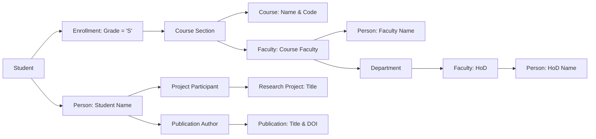

# University Healthcare and Research Management System (VIT)
## Comprehensive Case Study Solutions & System Architecture Specification

---

## Executive Summary & System Blueprint

This document provides an end-to-end, mathematically rigorous, and production-grade implementation of **Case Study – 4: University Healthcare and Research Management System (VIT)**. The solution spans comprehensive Enhanced Entity-Relationship (EER) modeling, relational schema conversion adhering to Third Normal Form (3NF), full SQL DDL/DML implementation using MySQL, analytical reporting queries, and a reference evaluation report.

### System Scope & Subsystems
1. **Core Human Resources & Identity Management**: Overlapping specialization of `Person` into `Student`, `Faculty`, `Staff`, and `Visiting Scholar`. Handles composite attributes (`Name`, `Address`), multi-valued attributes (`Phone_Number`, `Research_Interests`, `Skills`, `Certifications`), and derived attributes (`Age`, `Experience`).
2. **Academic & Departmental Administration**: Departments, Programs, Courses, and Weak Entity `Course_Section`. Faculty teaching assignments, student enrollment, grading, and HoD administrative hierarchies.
3. **Research & Publications Management**: Funded research projects, multi-role participant contributions (percentage and role), and scholarly publications with DOI, authorship rankings, and venue indexing.
4. **Library Circulation System**: Multi-copy tracking via Weak Entity `Book_Copy`, borrowing transactions, loan tracking, and automated fine calculation.
5. **Hostel & Residential Life**: Hostels, Weak Entity `Hostel_Room`, and room allocation history tracking room transitions and occupancy.
6. **University Healthcare Center**: Medical consultations, clinical diagnoses, doctor prescriptions, and multi-medicine dosage administration.
7. **Fleet Transportation Management**: Buses, routes, driver shift allocations, and student transport subscriptions.
8. **Student Extracurriculars & Clubs**: Club registrations, faculty advisorships, and leadership tenure tracking (President, Secretary, Treasurer).
9. **Online Learning Management System (LMS)**: Course modules, Weak Entity `Quiz_Question`, assignments, and Weak Entity `Assignment_Submission` with instructor evaluations.
10. **Faculty Mentoring & Research Supervision**: Recursive peer-mentoring between faculty members and graduate/undergraduate research supervision.

---

## Question 1: Comprehensive Entity-Relationship (E-R) Modeling (10 Marks)

### 1.1 Semantic E-R Design Specifications

#### A. Entities & Hierarchy
1. **Superclass Entity**:
   * `PERSON`: 
     * **Primary Key**: `Person_ID`
     * **Composite Attributes**:
       * `Name`: `(First_Name, Middle_Name, Last_Name)`
       * `Address`: `(Door_No, Street, City, State, Country, Postal_Code)`
     * **Simple Attributes**: `DOB`, `Gender`, `Primary_Email`
     * **Derived Attribute**: `Age` (Derived from `DOB` relative to `CURRENT_DATE`)
2. **Subclasses (Overlapping Specialization - `[O]` notation)**:
   * Individuals can concurrently hold multiple roles (e.g., a Faculty member pursuing research as a Student/Research Scholar, or Staff enrolled in courses).
   * `STUDENT`:
     * Attributes: `Roll_Number` (Unique Candidate Key / Subclass Identifier), `Program`, `Semester`, `CGPA`
     * **Multi-valued Attributes**: `Skills`, `Certifications`
   * `FACULTY`:
     * Attributes: `Employee_ID` (Unique Candidate Key / Subclass Identifier), `Designation`, `Salary`, `Joining_Date`
     * **Derived Attribute**: `Experience` (Derived from `Joining_Date` relative to `CURRENT_DATE`)
     * **Multi-valued Attributes**: `Faculty_Phones`, `Research_Interests`
   * `STAFF`:
     * Attributes: `Staff_ID`, `Shift_Details`
   * `VISITING_SCHOLAR`:
     * Attributes: `Scholar_ID`, `Home_University`, `Country`, `Visit_Duration_Days`

#### B. Departmental Entities & Relationships
3. `DEPARTMENT`:
   * Attributes: `Department_ID` (PK), `Department_Name`, `Building`, `Budget`
   * Relationships:
     * `Employs_Faculty`: (1:N, Total participation from Faculty) — Every faculty belongs to exactly one department.
     * `Employs_Staff`: (1:N, Total participation from Staff) — Every staff belongs to exactly one department.
     * `Headed_By` (HoD): (1:1, Partial participation from Faculty, Total from Department) — Each department is headed by exactly one faculty member.

#### C. Weak Entities & Identifying Relationships
According to strict database semantics, an entity is **weak** if its existence and identification depend on a parent entity:
1. `COURSE_SECTION` (identifying parent: `COURSE` via `1:N` identifying relationship `Offers_Section`):
   * Partial Key / Discriminator: `Section_ID`, `Semester`, `Academic_Year`
   * Primary Key: `(Course_ID, Section_ID, Semester, Academic_Year)`
2. `BOOK_COPY` (identifying parent: `BOOK` via `1:N` identifying relationship `Has_Copy`):
   * Partial Key / Discriminator: `Copy_Number`
   * Primary Key: `(ISBN, Copy_Number)`
   * Attributes: `Rack_Location`, `Current_Status` (Available, Issued, Under Maintenance)
3. `HOSTEL_ROOM` (identifying parent: `HOSTEL` via `1:N` identifying relationship `Contains_Room`):
   * Partial Key / Discriminator: `Room_Number`
   * Primary Key: `(Hostel_ID, Room_Number)`
   * Attributes: `Capacity`
4. `QUIZ_QUESTION` (identifying parent: `QUIZ` via `1:N` identifying relationship `Comprises_Question`):
   * Partial Key / Discriminator: `Question_Number`
   * Primary Key: `(Quiz_ID, Question_Number)`
   * Attributes: `Question_Text`, `Max_Marks`
5. `ASSIGNMENT_SUBMISSION` (identifying parent: `ASSIGNMENT` via `1:N` identifying relationship `Receives_Submission`):
   * Partial Key / Discriminator: `Roll_Number` (identifies submission per student)
   * Primary Key: `(Assignment_ID, Roll_Number)`
   * Attributes: `Submission_Time`, `Marks_Obtained`, `Instructor_Feedback`

#### D. Operational & Associative Relationships
* `ENROLLS`: Associative entity linking `STUDENT` and `COURSE_SECTION`. Records `Enrollment_Date`, `Grade`, and `Attendance_Percentage`.
* `TEACHES`: Relationship between `FACULTY` and `COURSE_SECTION`.
* `PROJECT_PARTICIPATION`: M:N ternary association between `PERSON` (`Faculty`, `Student`, `Visiting Scholar`) and `RESEARCH_PROJECT`. Records `Role`, `Joining_Date`, `Percentage_Contribution`.
* `PUBLICATION_AUTHOR`: M:N association between `PUBLICATION` and `PERSON`. Records `Authorship_Order`.
* `BORROW_TRANSACTION`: Relationship between `PERSON` (`Student`/`Faculty`) and `BOOK_COPY`. Records `Issue_Date`, `Due_Date`, `Return_Date`, and derived `Fine_Amount`.
* `ROOM_ALLOCATION`: History tracking relationship between `STUDENT` and `HOSTEL_ROOM`. Records `Check_In_Date`, `Check_Out_Date`.
* `MEDICAL_CONSULTATION`: Associative relationship between `PERSON` (patient), `DOCTOR`, and `PRESCRIPTION`. Records `Visit_Date`, `Diagnosis`.
* `PRESCRIBED_MEDICINE`: M:N association between `MEDICAL_CONSULTATION` and `MEDICINE`. Stores `Dosage` and `Instructions`.
* `BUS_ASSIGNMENT`: Driver schedule mapping `DRIVER` to `BUS` for a given `Assignment_Date` and `Shift`.
* `BUS_SUBSCRIPTION`: Student transit registration mapping `STUDENT` to `BUS_ROUTE`. Records `Subscription_Date`, `Fee_Paid`.
* `CLUB_MEMBERSHIP`: Student membership in `CLUB`. Records `Join_Date`, `Leadership_Role`, `Duration_Months`.
* `FACULTY_MENTORING`: Recursive 1:N relationship on `FACULTY` (Mentor -> Mentee) recording `Mentoring_Start_Date`.
* `RESEARCH_SUPERVISION`: 1:N relationship between `FACULTY` and `STUDENT` recording `Research_Area`, `Start_Date`.

---

### 1.2 Comprehensive E-R Diagram (Mermaid Visual Representation)


---

## Question 2: Relational Schema Conversion (10 Marks)

### 2.1 Formal Mapping Rules

1. **Mapping of Regular (Strong) Entities**:
   * Each strong entity is mapped directly into a relation containing all its atomic attributes.
   * Composite attributes (`Name`, `Address`) are flattened into atomic component attributes (`first_name`, `middle_name`, `last_name`, `door_no`, `street`, `city`, `state`, `country`, `postal_code`).
   * Primary keys remain the relation primary keys.
2. **Mapping of Weak Entities**:
   * For each weak entity, a relation is created containing all simple attributes of the weak entity.
   * The primary key of the identifying parent entity is included as a foreign key.
   * The primary key of the weak entity relation becomes the combination of the parent entity's primary key and the weak entity's partial key (discriminator).
   * *Examples*: `Course_Section`, `Book_Copy`, `Hostel_Room`, `Quiz_Question`, `Assignment_Submission`.
3. **Mapping of Specialization/Generalization (Overlapping Subclasses)**:
   * To support overlapping classifications cleanly without null attributes or redundancy, we utilize the **Multiple Relations with Foreign Keys (Option 8C)** strategy:
     * A base relation `Person` stores common personal attributes and primary key `person_id`.
     * Dedicated subclass relations (`Student`, `Faculty`, `Staff`, `Visiting_Scholar`) store role-specific attributes and reference `person_id` as a Foreign Key with `ON DELETE CASCADE`.
     * This naturally accommodates a person existing in both `Faculty` and `Student` relations simultaneously.
4. **Mapping of Multi-Valued Attributes**:
   * Each multi-valued attribute becomes a separate relation comprising the multi-valued attribute and the primary key of the parent entity as a foreign key.
   * The composite primary key consists of `(Parent_PK, Attribute_Value)`.
   * *Examples*: `Student_Skill`, `Student_Certification`, `Faculty_Phone`, `Faculty_Research_Interest`.
5. **Mapping of Binary 1:1 and 1:N Relationships**:
   * **1:1 (`Department` - `HoD Faculty`)**: The primary key of `Faculty` (`hod_faculty_id`) is placed as a foreign key in `Department`.
   * **1:N (`Department` - `Faculty`, `Department` - `Staff`)**: The primary key of `Department` (`department_id`) is placed as a foreign key in the N-side relations (`Faculty`, `Staff`).
6. **Mapping of Binary and Ternary M:N Relationships**:
   * A separate cross-reference relation is created whose primary key is composed of the primary keys of the participating entities, alongside any relationship attributes.
   * *Examples*: `Project_Participant`, `Publication_Author`, `Prescribed_Medicine`, `Bus_Assignment`.
7. **Mapping of Derived Attributes**:
   * Derived attributes (`age`, `experience`, `fine_amount`) are omitted from persistent base storage to prevent update anomalies, or implemented as SQL generated columns / views / triggers computed dynamically at query runtime.

---

### 2.2 Relational Schema Specification (3NF-Oriented Design)

*Notation: **PK** marks a column declared as an inline primary key. Composite primary keys and foreign-key constraints are defined in the complete SQL schema in Question 3.*

1. **`PERSON`** (Person_ID **PK**, First_Name, Middle_Name, Last_Name, Date_of_Birth, Gender, Phone, Email, Door_No, Street, City, State, Country, Postal_Code)
2. **`STUDENT`** (Person_ID **PK**, Roll_No, Program, Semester, CGPA)
3. **`FACULTY`** (Person_ID **PK**, Employee_ID, Designation, Salary, Joining_Date, Dept_ID, REFERENCES)
4. **`STAFF`** (Person_ID **PK**, Shift, Dept_ID, REFERENCES)
5. **`VISITING_SCHOLAR`** (Person_ID **PK**, Home_University, Country, Visit_Duration, REFERENCES)
6. **`DEPARTMENT`** (Dept_ID **PK**, Name, Building, Budget, HOD_Faculty_ID)
7. **`COURSE`** (Course_ID **PK**, Title, Credits)
8. **`COURSE_SECTION`** (Course_ID, Semester, Academic_Year, Section_No, Faculty_ID, REFERENCES, REFERENCES)
9. **`ENROLLMENT`** (Student_ID, Course_ID, Semester, Academic_Year, Section_No, Enrollment_Date, Grade, Attendance_Pct, REFERENCES, REFERENCES)
10. **`PROJECT`** (Project_ID **PK**, Title, Budget, Start_Date, End_Date)
11. **`PROJECT_PARTICIPATION`** (Person_ID, Project_ID, Role, Joining_Date, Contribution_Pct, REFERENCES, REFERENCES)
12. **`PUBLICATION`** (DOI **PK**, Title, Publication_Date, Venue_Details, Project_ID, REFERENCES)
13. **`AUTHORSHIP`** (Person_ID, DOI, Author_Order, REFERENCES, REFERENCES)
14. **`BOOK`** (ISBN **PK**, Title, Edition, Publisher)
15. **`BOOK_COPY`** (ISBN, Copy_No, Rack_Location, Status, REFERENCES)
16. **`BORROWING`** (Person_ID, ISBN, Copy_No, Issue_Date, Due_Date, Return_Date, Fine_Amount, REFERENCES, REFERENCES)
17. **`HOSTEL`** (Hostel_ID **PK**, Name, Hostel_Type)
18. **`ROOM`** (Hostel_ID, Room_No, Capacity, REFERENCES)
19. **`ROOM_ALLOCATION`** (Student_ID, Hostel_ID, Room_No, Check_In_Date, Check_Out_Date, REFERENCES, REFERENCES)
20. **`DOCTOR`** (Doctor_ID **PK**)
21. **`MEDICINE`** (Medicine_ID **PK**)
22. **`VISIT`** (Patient_ID, Doctor_ID, Visit_Date, Diagnosis, Prescription, REFERENCES, REFERENCES)
23. **`PRESCRIPTION_ITEM`** (Patient_ID, Doctor_ID, Visit_Date, Medicine_ID, Dosage, REFERENCES, REFERENCES)
24. **`DRIVER`** (Driver_ID **PK**)
25. **`BUS`** (Bus_ID **PK**, Route_No, Seating_Capacity)
26. **`BUS_ASSIGNMENT`** (Driver_ID, Bus_ID, Assignment_Date, Shift, REFERENCES, REFERENCES)
27. **`BUS_SUBSCRIPTION`** (Student_ID, Bus_ID, Subscription_Date, Fee_Paid, REFERENCES, REFERENCES)
28. **`CLUB`** (Club_ID **PK**, Name, Faculty_Advisor_ID, REFERENCES)
29. **`CLUB_MEMBERSHIP`** (Student_ID, Club_ID, Joining_Date, Position, Duration, REFERENCES, REFERENCES)
30. **`MODULE`** (Module_ID **PK**, Course_ID, REFERENCES)
31. **`VIDEO`** (Video_ID **PK**, Module_ID, REFERENCES)
32. **`ASSIGNMENT`** (Assignment_ID **PK**, Module_ID, REFERENCES)
33. **`QUIZ`** (Quiz_ID **PK**, Module_ID, REFERENCES)
34. **`QUIZ_QUESTION`** (Quiz_ID, Question_No, REFERENCES)
35. **`ASSIGNMENT_SUBMISSION`** (Assignment_ID, Submission_No, Student_ID, Submission_Time, Marks, Feedback, REFERENCES, REFERENCES)
36. **`MENTORING`** (Mentor_ID, Mentee_ID, Start_Date, REFERENCES, REFERENCES)
37. **`SUPERVISION`** (Faculty_ID, Student_ID, Research_Area, REFERENCES, REFERENCES)
38. **`FACULTY_PHONE`** (Faculty_ID, Phone_Number, REFERENCES)
39. **`FACULTY_RESEARCH_INTEREST`** (Faculty_ID, Research_Interest, REFERENCES)
40. **`STUDENT_SKILL`** (Student_ID, Skill, REFERENCES)
41. **`STUDENT_CERTIFICATION`** (Student_ID, Certification, REFERENCES)

---

## Question 3: Relational Implementation (SQL DDL & Data Population) (10 Marks)

### 3.1 DDL Script (PostgreSQL / MySQL Compliant)

```sql
-- ============================================================================
-- UNIVERSITY HEALTHCARE AND RESEARCH MANAGEMENT SYSTEM (VIT)
-- SCHEMA CREATION SCRIPT
-- ============================================================================

CREATE DATABASE IF NOT EXISTS university_management;
USE university_management;
CREATE TABLE PERSON (
    Person_ID INT PRIMARY KEY,
    First_Name VARCHAR(50) NOT NULL,
    Middle_Name VARCHAR(50),
    Last_Name VARCHAR(50) NOT NULL,
    Date_of_Birth DATE,
    Gender VARCHAR(20),
    Phone VARCHAR(15),
    Email VARCHAR(100),
    Door_No VARCHAR(20),
    Street VARCHAR(100),
    City VARCHAR(50),
    State VARCHAR(50),
    Country VARCHAR(50),
    Postal_Code VARCHAR(10)
);
CREATE TABLE STUDENT (
    Person_ID INT PRIMARY KEY,
    Roll_No VARCHAR(20) UNIQUE NOT NULL,
    Program VARCHAR(100),
    Semester INT,
    CGPA DECIMAL(3,2),

    FOREIGN KEY (Person_ID)
        REFERENCES PERSON(Person_ID)
);
CREATE TABLE FACULTY (
    Person_ID INT PRIMARY KEY,
    Employee_ID VARCHAR(20) UNIQUE NOT NULL,
    Designation VARCHAR(100),
    Salary DECIMAL(12,2),
    Joining_Date DATE,
    Dept_ID INT,

    FOREIGN KEY (Person_ID)
        REFERENCES PERSON(Person_ID)
);
CREATE TABLE STAFF (
    Person_ID INT PRIMARY KEY,
    Shift VARCHAR(30),
    Dept_ID INT,

    FOREIGN KEY (Person_ID)
        REFERENCES PERSON(Person_ID)
);
CREATE TABLE VISITING_SCHOLAR (
    Person_ID INT PRIMARY KEY,
    Home_University VARCHAR(150),
    Country VARCHAR(50),
    Visit_Duration VARCHAR(50),

    FOREIGN KEY (Person_ID)
        REFERENCES PERSON(Person_ID)
);
CREATE TABLE DEPARTMENT (
    Dept_ID INT PRIMARY KEY,
    Name VARCHAR(100) NOT NULL,
    Building VARCHAR(100),
    Budget DECIMAL(15,2),
    HOD_Faculty_ID INT UNIQUE
);
ALTER TABLE FACULTY
ADD CONSTRAINT fk_faculty_department
FOREIGN KEY (Dept_ID)
REFERENCES DEPARTMENT(Dept_ID);

ALTER TABLE STAFF
ADD CONSTRAINT fk_staff_department
FOREIGN KEY (Dept_ID)
REFERENCES DEPARTMENT(Dept_ID);

ALTER TABLE DEPARTMENT
ADD CONSTRAINT fk_department_hod
FOREIGN KEY (HOD_Faculty_ID)
REFERENCES FACULTY(Person_ID);

CREATE TABLE COURSE (
    Course_ID INT PRIMARY KEY,
    Title VARCHAR(150) NOT NULL,
    Credits INT
);
CREATE TABLE COURSE_SECTION (
    Course_ID INT,
    Semester VARCHAR(20),
    Academic_Year VARCHAR(20),
    Section_No VARCHAR(10),
    Faculty_ID INT,

    PRIMARY KEY (
        Course_ID,
        Semester,
        Academic_Year,
        Section_No
    ),

    FOREIGN KEY (Course_ID)
        REFERENCES COURSE(Course_ID),

    FOREIGN KEY (Faculty_ID)
        REFERENCES FACULTY(Person_ID)
);
CREATE TABLE ENROLLMENT (
    Student_ID INT,
    Course_ID INT,
    Semester VARCHAR(20),
    Academic_Year VARCHAR(20),
    Section_No VARCHAR(10),
    Enrollment_Date DATE,
    Grade VARCHAR(5),
    Attendance_Pct DECIMAL(5,2),

    PRIMARY KEY (
        Student_ID,
        Course_ID,
        Semester,
        Academic_Year,
        Section_No
    ),

    FOREIGN KEY (Student_ID)
        REFERENCES STUDENT(Person_ID),

    FOREIGN KEY (
        Course_ID,
        Semester,
        Academic_Year,
        Section_No
    )
        REFERENCES COURSE_SECTION(
            Course_ID,
            Semester,
            Academic_Year,
            Section_No
        )
);
CREATE TABLE PROJECT (
    Project_ID INT PRIMARY KEY,
    Title VARCHAR(200),
    Budget DECIMAL(15,2),
    Start_Date DATE,
    End_Date DATE
);
CREATE TABLE PROJECT_PARTICIPATION (
    Person_ID INT,
    Project_ID INT,
    Role VARCHAR(100),
    Joining_Date DATE,
    Contribution_Pct DECIMAL(5,2),

    PRIMARY KEY (Person_ID, Project_ID),

    FOREIGN KEY (Person_ID)
        REFERENCES PERSON(Person_ID),

    FOREIGN KEY (Project_ID)
        REFERENCES PROJECT(Project_ID)
);
CREATE TABLE PUBLICATION (
    DOI VARCHAR(100) PRIMARY KEY,
    Title VARCHAR(250),
    Publication_Date DATE,
    Venue_Details VARCHAR(250),
    Project_ID INT,

    FOREIGN KEY (Project_ID)
        REFERENCES PROJECT(Project_ID)
);
CREATE TABLE AUTHORSHIP (
    Person_ID INT,
    DOI VARCHAR(100),
    Author_Order INT,

    PRIMARY KEY (Person_ID, DOI),

    FOREIGN KEY (Person_ID)
        REFERENCES PERSON(Person_ID),

    FOREIGN KEY (DOI)
        REFERENCES PUBLICATION(DOI)
);
CREATE TABLE BOOK (
    ISBN VARCHAR(20) PRIMARY KEY,
    Title VARCHAR(200),
    Edition VARCHAR(50),
    Publisher VARCHAR(150)
);
CREATE TABLE BOOK_COPY (
    ISBN VARCHAR(20),
    Copy_No INT,
    Rack_Location VARCHAR(50),
    Status VARCHAR(30),

    PRIMARY KEY (ISBN, Copy_No),

    FOREIGN KEY (ISBN)
        REFERENCES BOOK(ISBN)
);
CREATE TABLE BORROWING (
    Person_ID INT,
    ISBN VARCHAR(20),
    Copy_No INT,
    Issue_Date DATE,
    Due_Date DATE,
    Return_Date DATE,
    Fine_Amount DECIMAL(10,2),

    PRIMARY KEY (
        Person_ID,
        ISBN,
        Copy_No,
        Issue_Date
    ),

    FOREIGN KEY (Person_ID)
        REFERENCES PERSON(Person_ID),

    FOREIGN KEY (ISBN, Copy_No)
        REFERENCES BOOK_COPY(ISBN, Copy_No)
);
CREATE TABLE HOSTEL (
    Hostel_ID INT PRIMARY KEY,
    Name VARCHAR(100),
    Hostel_Type VARCHAR(50)
);
CREATE TABLE ROOM (
    Hostel_ID INT,
    Room_No VARCHAR(20),
    Capacity INT,

    PRIMARY KEY (Hostel_ID, Room_No),

    FOREIGN KEY (Hostel_ID)
        REFERENCES HOSTEL(Hostel_ID)
);
CREATE TABLE ROOM_ALLOCATION (
    Student_ID INT,
    Hostel_ID INT,
    Room_No VARCHAR(20),
    Check_In_Date DATE,
    Check_Out_Date DATE,

    PRIMARY KEY (
        Student_ID,
        Hostel_ID,
        Room_No,
        Check_In_Date
    ),

    FOREIGN KEY (Student_ID)
        REFERENCES STUDENT(Person_ID),

    FOREIGN KEY (Hostel_ID, Room_No)
        REFERENCES ROOM(Hostel_ID, Room_No)
);
CREATE TABLE DOCTOR (
    Doctor_ID INT PRIMARY KEY
);
CREATE TABLE MEDICINE (
    Medicine_ID INT PRIMARY KEY
);
CREATE TABLE VISIT (
    Patient_ID INT,
    Doctor_ID INT,
    Visit_Date DATE,
    Diagnosis VARCHAR(250),
    Prescription VARCHAR(500),

    PRIMARY KEY (
        Patient_ID,
        Doctor_ID,
        Visit_Date
    ),

    FOREIGN KEY (Patient_ID)
        REFERENCES PERSON(Person_ID),

    FOREIGN KEY (Doctor_ID)
        REFERENCES DOCTOR(Doctor_ID)
);
CREATE TABLE PRESCRIPTION_ITEM (
    Patient_ID INT,
    Doctor_ID INT,
    Visit_Date DATE,
    Medicine_ID INT,
    Dosage VARCHAR(100),

    PRIMARY KEY (
        Patient_ID,
        Doctor_ID,
        Visit_Date,
        Medicine_ID
    ),

    FOREIGN KEY (
        Patient_ID,
        Doctor_ID,
        Visit_Date
    )
        REFERENCES VISIT(
            Patient_ID,
            Doctor_ID,
            Visit_Date
        ),

    FOREIGN KEY (Medicine_ID)
        REFERENCES MEDICINE(Medicine_ID)
);
CREATE TABLE DRIVER (
    Driver_ID INT PRIMARY KEY
);
CREATE TABLE BUS (
    Bus_ID INT PRIMARY KEY,
    Route_No VARCHAR(20),
    Seating_Capacity INT
);
CREATE TABLE BUS_ASSIGNMENT (
    Driver_ID INT,
    Bus_ID INT,
    Assignment_Date DATE,
    Shift VARCHAR(30),

    PRIMARY KEY (
        Driver_ID,
        Bus_ID,
        Assignment_Date,
        Shift
    ),

    FOREIGN KEY (Driver_ID)
        REFERENCES DRIVER(Driver_ID),

    FOREIGN KEY (Bus_ID)
        REFERENCES BUS(Bus_ID)
);
CREATE TABLE BUS_SUBSCRIPTION (
    Student_ID INT,
    Bus_ID INT,
    Subscription_Date DATE,
    Fee_Paid DECIMAL(10,2),

    PRIMARY KEY (Student_ID, Bus_ID),

    FOREIGN KEY (Student_ID)
        REFERENCES STUDENT(Person_ID),

    FOREIGN KEY (Bus_ID)
        REFERENCES BUS(Bus_ID)
);
CREATE TABLE CLUB (
    Club_ID INT PRIMARY KEY,
    Name VARCHAR(100),
    Faculty_Advisor_ID INT,

    FOREIGN KEY (Faculty_Advisor_ID)
        REFERENCES FACULTY(Person_ID)
);

CREATE TABLE CLUB_MEMBERSHIP (
    Student_ID INT,
    Club_ID INT,
    Joining_Date DATE,
    Position VARCHAR(30),
    Duration VARCHAR(50),

    PRIMARY KEY (Student_ID, Club_ID),

    FOREIGN KEY (Student_ID)
        REFERENCES STUDENT(Person_ID),

    FOREIGN KEY (Club_ID)
        REFERENCES CLUB(Club_ID)
);
CREATE TABLE MODULE (
    Module_ID INT PRIMARY KEY,
    Course_ID INT,

    FOREIGN KEY (Course_ID)
        REFERENCES COURSE(Course_ID)
);
CREATE TABLE VIDEO (
    Video_ID INT PRIMARY KEY,
    Module_ID INT,

    FOREIGN KEY (Module_ID)
        REFERENCES MODULE(Module_ID)
);
CREATE TABLE ASSIGNMENT (
    Assignment_ID INT PRIMARY KEY,
    Module_ID INT,

    FOREIGN KEY (Module_ID)
        REFERENCES MODULE(Module_ID)
);
CREATE TABLE QUIZ (
    Quiz_ID INT PRIMARY KEY,
    Module_ID INT,

    FOREIGN KEY (Module_ID)
        REFERENCES MODULE(Module_ID)
);
CREATE TABLE QUIZ_QUESTION (
    Quiz_ID INT,
    Question_No INT,

    PRIMARY KEY (Quiz_ID, Question_No),

    FOREIGN KEY (Quiz_ID)
        REFERENCES QUIZ(Quiz_ID)
);
CREATE TABLE ASSIGNMENT_SUBMISSION (
    Assignment_ID INT,
    Submission_No INT,
    Student_ID INT,
    Submission_Time DATETIME,
    Marks DECIMAL(5,2),
    Feedback VARCHAR(500),

    PRIMARY KEY (
        Assignment_ID,
        Submission_No
    ),

    FOREIGN KEY (Assignment_ID)
        REFERENCES ASSIGNMENT(Assignment_ID),

    FOREIGN KEY (Student_ID)
        REFERENCES STUDENT(Person_ID)
);
CREATE TABLE MENTORING (
    Mentor_ID INT,
    Mentee_ID INT,
    Start_Date DATE,

    PRIMARY KEY (Mentor_ID, Mentee_ID),

    FOREIGN KEY (Mentor_ID)
        REFERENCES FACULTY(Person_ID),

    FOREIGN KEY (Mentee_ID)
        REFERENCES FACULTY(Person_ID)
);
CREATE TABLE SUPERVISION (
    Faculty_ID INT,
    Student_ID INT,
    Research_Area VARCHAR(200),

    PRIMARY KEY (Faculty_ID, Student_ID),

    FOREIGN KEY (Faculty_ID)
        REFERENCES FACULTY(Person_ID),

    FOREIGN KEY (Student_ID)
        REFERENCES STUDENT(Person_ID)
);
CREATE TABLE FACULTY_PHONE (
    Faculty_ID INT,
    Phone_Number VARCHAR(15),

    PRIMARY KEY (Faculty_ID, Phone_Number),

    FOREIGN KEY (Faculty_ID)
        REFERENCES FACULTY(Person_ID)
);
CREATE TABLE FACULTY_RESEARCH_INTEREST (
    Faculty_ID INT,
    Research_Interest VARCHAR(150),

    PRIMARY KEY (Faculty_ID, Research_Interest),

    FOREIGN KEY (Faculty_ID)
        REFERENCES FACULTY(Person_ID)
);
CREATE TABLE STUDENT_SKILL (
    Student_ID INT,
    Skill VARCHAR(100),

    PRIMARY KEY (Student_ID, Skill),

    FOREIGN KEY (Student_ID)
        REFERENCES STUDENT(Person_ID)
);
CREATE TABLE STUDENT_CERTIFICATION (
    Student_ID INT,
    Certification VARCHAR(150),

    PRIMARY KEY (Student_ID, Certification),

    FOREIGN KEY (Student_ID)
        REFERENCES STUDENT(Person_ID)
);
```

---

### 3.2 Coherent Production Data Insertion (DML Scripts)

```sql
-- ============================================================================
-- DML DATA POPULATION: REALISTIC & INTEGRATED VIT UNIVERSITY DATA
-- ============================================================================

USE university_management;

INSERT INTO PERSON
(Person_ID, First_Name, Middle_Name, Last_Name, Date_of_Birth, Gender, Phone, Email,
 Door_No, Street, City, State, Country, Postal_Code)
VALUES(1001, 'Aarav', NULL, 'Sharma', '2004-05-12', 'Male', '9876543210', 'aarav.sharma@vitstudent.ac.in',
 '12', 'Green Park', 'New Delhi', 'Delhi', 'India', '110016'),
(1002, 'Ananya', 'R', 'Iyer', '2004-08-21', 'Female', '9876543211', 'ananya.iyer@vitstudent.ac.in',
 '24', 'Indiranagar', 'Bengaluru', 'Karnataka', 'India', '560038'),
(1003, 'Rohan', NULL, 'Mehta', '2003-11-03', 'Male', '9876543212', 'rohan.mehta@vitstudent.ac.in',
 '8', 'Andheri Road', 'Mumbai', 'Maharashtra', 'India', '400058'),
(1004, 'Diya', 'S', 'Nair', '2005-02-17', 'Female', '9876543213', 'diya.nair@vitstudent.ac.in',
 '31', 'MG Road', 'Kochi', 'Kerala', 'India', '682016'),
(1005, 'Karthik', NULL, 'Reddy', '2004-12-10', 'Male', '9876543214', 'karthik.reddy@vitstudent.ac.in',
 '16', 'Banjara Hills', 'Hyderabad', 'Telangana', 'India', '500034'),
(1006, 'Meera', 'P', 'Krishnan', '2005-06-25', 'Female', '9876543215', 'meera.krishnan@vitstudent.ac.in',
 '45', 'Salt Lake', 'Kolkata', 'West Bengal', 'India', '700091'),
(2001, 'Rajesh', 'Kumar', 'Verma', '1978-04-14', 'Male', '9000001001', 'rajesh.verma@vit.ac.in',
 '101', 'Hazratganj', 'Lucknow', 'Uttar Pradesh', 'India', '226001'),
(2002, 'Priya', 'S', 'Menon', '1982-09-08', 'Female', '9000001002', 'priya.menon@vit.ac.in',
 '102', 'Vazhuthacaud', 'Thiruvananthapuram', 'Kerala', 'India', '695014'),
(2003, 'Arvind', NULL, 'Krishnan', '1975-12-19', 'Male', '9000001003', 'arvind.krishnan@vit.ac.in',
 '103', 'MVP Colony', 'Visakhapatnam', 'Andhra Pradesh', 'India', '530017'),
(3001, 'Suresh', NULL, 'Kumar', '1985-03-22', 'Male', '9000001004', 'suresh.kumar@vit.ac.in',
 '15', 'Malviya Nagar', 'Jaipur', 'Rajasthan', 'India', '302017');
 
INSERT INTO DEPARTMENT(Dept_ID, Name, Building, Budget, HOD_Faculty_ID)
VALUES(101, 'Computer Science and Engineering', 'PRP', 50000000.00, NULL),
(102, 'Information Technology', 'SJT', 35000000.00, NULL),
(103, 'Electronics and Communication Engineering', 'TT', 45000000.00, NULL);

INSERT INTO STUDENT(Person_ID, Roll_No, Program, Semester, CGPA)
VALUES(1001, '24BDS0125', 'B.Tech Computer Science and Engineering (Data Science)', 5, 8.75),
(1002, '24BDS0130', 'B.Tech Computer Science and Engineering (Data Science)', 5, 9.12),
(1003, '24BCE0187', 'B.Tech Computer Science and Engineering Core', 5, 8.60),
(1004, '24BCT0201', 'B.Tech Computer Science and Engineering (Internet of Things)', 5, 9.35),
(1005, '24BAI0215', 'B.Tech Computer Science and Engineering (AI & ML)', 5, 8.45),
(1006, '24BCI0098', 'B.Tech Computer Science and Engineering (Data Science)', 5, 9.05);

INSERT INTO FACULTY(Person_ID, Employee_ID, Designation, Salary, Joining_Date, Dept_ID)
VALUES(2001, 'EMP1001', 'Professor', 150000.00, '2022-06-15', 101),
(2002, 'EMP1002', 'Associate Professor', 125000.00, '2018-07-10', 102),
(2003, 'EMP1003', 'Professor', 145000.00, '2015-01-20', 103);

UPDATE DEPARTMENT
SET HOD_Faculty_ID = 2001
WHERE Dept_ID = 101;
UPDATE DEPARTMENT
SET HOD_Faculty_ID = 2002
WHERE Dept_ID = 102;
UPDATE DEPARTMENT
SET HOD_Faculty_ID = 2003
WHERE Dept_ID = 103;
 
INSERT INTO STAFF(Person_ID, Shift, Dept_ID)
VALUES(3001, 'Morning', 101);

INSERT INTO VISITING_SCHOLAR(Person_ID, Home_University, Country, Visit_Duration)
VALUES(1006, 'Indian Institute of Science', 'India', '6 Months');

INSERT INTO COURSE(Course_ID, Title, Credits)
VALUES(501, 'Database Systems', 4),
(502, 'Compiler Design', 4),
(503, 'Computer Networks', 3),
(504, 'Operating Systems', 4),
(505, 'Artificial Intelligence', 3);

INSERT INTO COURSE_SECTION(Course_ID, Semester, Academic_Year, Section_No, Faculty_ID)
VALUES(501, 'Fall', '2026-27', 'A', 2001),
(502, 'Fall', '2026-27', 'A', 2002),
(503, 'Fall', '2026-27', 'A', 2003),
(504, 'Fall', '2026-27', 'A', 2001),
(505, 'Fall', '2026-27', 'A', 2002);

INSERT INTO ENROLLMENT(Student_ID, Course_ID, Semester, Academic_Year, Section_No,
Enrollment_Date, Grade, Attendance_Pct)
VALUES(1001, 501, 'Fall', '2026-27', 'A', '2026-07-06', 'S', 96.00),
(1002, 501, 'Fall', '2026-27', 'A', '2026-07-06', 'A', 91.00),
(1003, 502, 'Fall', '2026-27', 'A', '2026-07-06', 'S', 94.00),
(1004, 502, 'Fall', '2026-27', 'A', '2026-07-06', 'A', 97.00),
(1005, 503, 'Fall', '2026-27', 'A', '2026-07-06', 'B', 88.00),
(1006, 504, 'Fall', '2026-27', 'A', '2026-07-06', 'S', 95.00),
(1001, 505, 'Fall', '2026-27', 'A', '2026-07-06', 'A', 93.00);

INSERT INTO PROJECT(Project_ID, Title, Budget, Start_Date, End_Date)
VALUES(701, 'AI Based Network Intrusion Detection', 800000.00, '2025-07-01', '2027-06-30'),
(702, 'Smart Healthcare Analytics', 650000.00, '2025-08-01', '2027-07-31'),
(703, 'Intelligent Transportation System', 500000.00, '2026-01-15', '2027-12-31');

INSERT INTO PROJECT_PARTICIPATION(Person_ID, Project_ID, Role, Joining_Date, Contribution_Pct)
VALUES(2001, 701, 'Principal Investigator', '2025-07-01', 40.00),
(1001, 701, 'Student Researcher', '2025-08-01', 20.00),
(1003, 701, 'Student Researcher', '2025-08-15', 20.00),
(1006, 701, 'Research Assistant', '2025-09-01', 20.00),
(2002, 702, 'Principal Investigator', '2025-08-01', 50.00),
(1004, 702, 'Student Researcher', '2025-09-01', 25.00),
(2003, 703, 'Principal Investigator', '2026-01-15', 50.00);

INSERT INTO PUBLICATION(DOI, Title, Publication_Date, Venue_Details, Project_ID)
VALUES('10.1000/ids001','Machine Learning Based Network Intrusion Detection',
'2026-02-15','International Conference on Cyber Security',701),
('10.1000/health002','Healthcare Analytics Using Machine Learning',
 '2026-04-20','International Journal of Healthcare Technology',702),
('10.1000/trans003','Intelligent Transportation Analytics',
 '2026-06-10','Smart Systems Research Conference',703);
 
INSERT INTO AUTHORSHIP(Person_ID, DOI, Author_Order)
VALUES(2001, '10.1000/ids001', 1),
(1001, '10.1000/ids001', 2),
(1003, '10.1000/ids001', 3),
(1006, '10.1000/ids001', 4),
(2002, '10.1000/health002', 1),
(1004, '10.1000/health002', 2),
(2003, '10.1000/trans003', 1);

INSERT INTO BOOK(ISBN, Title, Edition, Publisher)
VALUES('9780133970777', 'Database System Concepts', '7th', 'McGraw Hill'),
('9780133594140', 'Computer Networking', '6th', 'Pearson'),
('9780262046305', 'Artificial Intelligence', '4th', 'MIT Press'),
('9780262033848', 'Compiler Design', '4th', 'MIT Press');

INSERT INTO BOOK_COPY(ISBN, Copy_No, Rack_Location, Status)
VALUES('9780133970777', 1, 'R1-A01', 'Available'),
('9780133970777', 2, 'R1-A02', 'Issued'),
('9780133594140', 1, 'R2-B01', 'Available'),
('9780262046305', 1, 'R3-C01', 'Issued'),
('9780262033848', 1, 'R4-D01', 'Available');

INSERT INTO BORROWING(Person_ID, ISBN, Copy_No, Issue_Date, Due_Date, Return_Date, Fine_Amount)
VALUES(1001, '9780133970777', 2, '2026-08-01', '2026-08-15', NULL, 0.00),
(1002, '9780133594140', 1, '2026-08-05', '2026-08-19', '2026-08-18', 0.00),
(2001, '9780262046305', 1, '2026-08-10', '2026-08-24', NULL, 0.00),
(1003, '9780133970777', 1, '2026-07-01', '2026-07-15', '2026-07-18', 30.00);

INSERT INTO HOSTEL(Hostel_ID, Name, Hostel_Type)
VALUES(801, 'Swami Vivekanand Block', "Men's Hostel"),
(802, 'Marie Curie Block', "Ladies's Hostel"),
(803, 'Subhas Chandra Bose Block',"Men's Hostel");

INSERT INTO ROOM(Hostel_ID, Room_No, Capacity)
VALUES(801, '101', 6),
(801, '102', 2),
(802, '201', 4),
(802, '202', 2),
(803, '301', 3);

INSERT INTO ROOM_ALLOCATION(Student_ID, Hostel_ID, Room_No, Check_In_Date, Check_Out_Date)
VALUES(1001, 801, '101', '2026-07-05', NULL),
(1003, 801, '102', '2026-07-05', NULL),
(1005, 803, '301', '2026-07-05', NULL),
(1002, 802, '201', '2026-07-05', NULL),
(1004, 802, '202', '2026-07-05', NULL);

INSERT INTO DOCTOR(Doctor_ID)
VALUES(901),(902),(903);

INSERT INTO MEDICINE(Medicine_ID)
VALUES(10001),(10002),(10003),(10004);

INSERT INTO VISIT(Patient_ID, Doctor_ID, Visit_Date, Diagnosis, Prescription)
VALUES(1001, 901, '2026-08-05', 'Fever', 'Paracetamol'),
(1002, 902, '2026-08-07', 'Cold and Cough', 'Cough medication'),
(1003, 901, '2026-08-10', 'Headache', 'Pain relief medication'),
(2001, 903, '2026-08-12', 'Back Pain', 'Pain relief medication');

INSERT INTO PRESCRIPTION_ITEM(Patient_ID, Doctor_ID, Visit_Date, Medicine_ID, Dosage)
VALUES(1001, 901, '2026-08-05', 10001, '500 mg twice daily'),
(1002, 902, '2026-08-07', 10002, '10 ml twice daily'),
(1003, 901, '2026-08-10', 10003, '500 mg once daily'),
(2001, 903, '2026-08-12', 10004, '1 tablet after food');

INSERT INTO DRIVER(Driver_ID)
VALUES(1101),(1102),(1103);

INSERT INTO BUS(Bus_ID, Route_No, Seating_Capacity)
VALUES(1201, 'VLR-01', 50),(1202, 'VLR-02', 45),(1203, 'VLR-03', 50);

INSERT INTO BUS_ASSIGNMENT(Driver_ID, Bus_ID, Assignment_Date, Shift)
VALUES(1101, 1201, '2026-08-01', 'Morning'),(1102, 1202, '2026-08-01', 'Morning'),
(1103, 1203, '2026-08-01', 'Evening');

INSERT INTO BUS_SUBSCRIPTION(Student_ID, Bus_ID, Subscription_Date, Fee_Paid)
VALUES(1001, 1201, '2026-07-10', 5000.00),
(1002, 1202, '2026-07-10', 5000.00),
(1003, 1201, '2026-07-10', 5000.00),
(1004, 1203, '2026-07-10', 5000.00),
(1005, 1202, '2026-07-10', 5000.00);

INSERT INTO CLUB(Club_ID, Name, Faculty_Advisor_ID)
VALUES(1301, 'IEEE Student Branch & Societies', 2001),
(1302, 'Rotor FPV Club', 2003),
(1303, 'SAE VIT Club', 2001),
(1304, 'AI and Robotics Club', 2002);

INSERT INTO CLUB_MEMBERSHIP(Student_ID, Club_ID, Joining_Date, Position, Duration)
VALUES(1001, 1301, '2025-08-01', 'Member', '2 Years'),
(1001, 1304, '2025-08-05', 'Secretary', '2 Years'),
(1002, 1302, '2025-08-03', 'President', '2 Years'),
(1003, 1303, '2025-08-10', 'Member', '2 Years'),
(1004, 1302, '2025-08-04', 'Member', '2 Years'),
(1005, 1301, '2025-08-02', 'Member', '2 Years'),
(1006, 1304, '2025-08-06', 'Technical Lead', '2 Years');

INSERT INTO MODULE(Module_ID, Course_ID)
VALUES(1401, 501),(1402, 501),(1403, 502),
(1404, 503),(1405, 504);

INSERT INTO VIDEO(Video_ID, Module_ID)
VALUES(1501, 1401),(1502, 1401),(1503, 1402),
(1504, 1403),(1505, 1404);

INSERT INTO ASSIGNMENT(Assignment_ID, Module_ID)
VALUES(1601, 1401),(1602, 1402),(1603, 1403),
(1604, 1404),(1605, 1405);

INSERT INTO QUIZ(Quiz_ID, Module_ID)
VALUES(1701, 1401),(1702, 1402),(1703, 1403),(1704, 1404);

INSERT INTO QUIZ_QUESTION(Quiz_ID, Question_No)
VALUES(1701, 1),(1701, 2),(1701, 3),(1702, 1),
(1702, 2),(1703, 1),(1703, 2),(1704, 1);

INSERT INTO ASSIGNMENT_SUBMISSION
(Assignment_ID, Submission_No, Student_ID, Submission_Time, Marks, Feedback)
VALUES(1601, 1, 1001, '2026-08-10 10:30:00', 92.00, 'Excellent work'),
(1601, 2, 1002, '2026-08-10 11:00:00', 88.00, 'Good analysis'),
(1602, 1, 1003, '2026-08-12 14:00:00', 90.00, 'Well structured'),
(1603, 1, 1004, '2026-08-15 16:30:00', 95.00, 'Excellent implementation'),
(1604, 1, 1005, '2026-08-17 12:00:00', 84.00, 'Good attempt'),
(1605, 1, 1006, '2026-08-20 15:00:00', 91.00, 'Very good work');

INSERT INTO MENTORING(Mentor_ID, Mentee_ID, Start_Date)
VALUES(2001, 2002, '2024-07-08'),(2001, 2003, '2024-07-08'),
(2002, 2003, '2025-07-08');

INSERT INTO SUPERVISION(Faculty_ID, Student_ID, Research_Area)
VALUES(2001, 1001, 'Network Security and Intrusion Detection'),
(2001, 1003, 'Machine Learning for Cyber Security'),
(2002, 1004, 'Healthcare Data Analytics'),
(2003, 1006, 'Intelligent Transportation Systems');

INSERT INTO FACULTY_PHONE(Faculty_ID, Phone_Number)
VALUES(2001, '9000001001'),(2001, '9000001101'),
(2002, '9000001002'),(2002, '9000001102'),
(2003, '9000001003'),(2003, '9000001103');

INSERT INTO FACULTY_RESEARCH_INTEREST(Faculty_ID, Research_Interest)
VALUES(2001, 'Network Security'),(2001, 'Machine Learning'),
(2002, 'Artificial Intelligence'),(2002, 'Healthcare Analytics'),
(2003, 'Intelligent Transportation'),(2003, 'Computer Networks');

INSERT INTO STUDENT_SKILL(Student_ID, Skill)
VALUES(1001, 'Python'),(1001, 'SQL'),(1002, 'Machine Learning'),
(1002, 'Python'),(1003, 'Java'),(1003, 'Cyber Security'),
(1004, 'Data Analytics'),(1004, 'Python'),
(1005, 'C++'),(1006, 'Artificial Intelligence');

INSERT INTO STUDENT_CERTIFICATION(Student_ID, Certification)
VALUES(1001, 'Oracle Database SQL Certified'),
(1002, 'Microsoft Azure AI Fundamentals'),
(1003, 'Cisco Cybersecurity Essentials'),
(1004, 'IBM Data Science Certificate'),
(1005, 'AWS Cloud Practitioner'),
(1006, 'Google Data Analytics Certificate');
```

---

## Question 4: APJ Abdul Kalam Award Recognition Query & Analytics (10 Marks)

### 4.1 Business Logic & Join Architecture

The university policy awards the prestigious **“APJ Abdul Kalam” Award** to elite students who simultaneously satisfy two criteria:
1. **Academic Excellence**: Score an **‘S’ grade** (Special Outstanding grade) in a university course.
2. **Scholarly Research Participation**: Participate in a **university research project**, with associated research publication details included in the report where available.

The Deans require a report containing:
`Student Name, RegNo, Course Name, Course Code, Course Faculty ID, Course Faculty Name, HoD Name, Course grade, Research Work, Research work publication`.

#### Join Pathway


---

### 4.2 Production SQL Query

```sql
-- ============================================================================
-- UNIVERSITY HEALTHCARE AND RESEARCH MANAGEMENT SYSTEM (VIT)
-- QUESTION 4: APJ ABDUL KALAM AWARD RECOGNITION QUERY
-- ============================================================================
-- Business Logic:
-- Retrieves students who:
-- 1. Are actively engaged in university research projects (PROJECT_PARTICIPATION)
-- 2. Have a publication associated with their research project
-- 3. Scored an outstanding 'S' grade in course evaluations (Enrollment)
-- ============================================================================

USE university_management;

SELECT
    'APJ Abdul Kalam Award - Eligible Students' AS `Award Title`,
    CONCAT_WS(' ', sp.First_Name, sp.Middle_Name, sp.Last_Name)
        AS `Student Name`,
    s.Roll_No AS `RegNo`,
    c.Title AS `Course Name`,
    c.Course_ID AS `Course Code`,
    cs.Faculty_ID AS `Course Faculty ID`,
    CONCAT_WS(' ', fp.First_Name, fp.Middle_Name, fp.Last_Name)
        AS `Course Faculty Name`,
    CONCAT_WS(' ', hp.First_Name, hp.Middle_Name, hp.Last_Name)
        AS `HoD Name`,
    e.Grade AS `Course Grade`,
    pr.Title AS `Research Work`,
    pub.Title AS `Research Work Publication`
FROM STUDENT s
-- Connect student to person details
JOIN PERSON sp
    ON sp.Person_ID = s.Person_ID
-- Connect student to course enrollments with 'S' Grade
JOIN ENROLLMENT e
    ON e.Student_ID = s.Person_ID
-- Connect enrollment to the specific course section    
JOIN COURSE_SECTION cs
    ON cs.Course_ID = e.Course_ID
   AND cs.Semester = e.Semester
   AND cs.Academic_Year = e.Academic_Year
   AND cs.Section_No = e.Section_No
-- Connect section to the course details   
JOIN COURSE c
    ON c.Course_ID = cs.Course_ID
-- Connect section to the course faculty    
JOIN FACULTY cf
    ON cf.Person_ID = cs.Faculty_ID
-- Connect course faculty to department and identify the department HoD    
JOIN PERSON fp
    ON fp.Person_ID = cf.Person_ID
JOIN DEPARTMENT d
    ON d.Dept_ID = cf.Dept_ID
JOIN FACULTY hf
    ON hf.Person_ID = d.HOD_Faculty_ID
JOIN PERSON hp
    ON hp.Person_ID = hf.Person_ID
-- Verify research project engagement    
JOIN PROJECT_PARTICIPATION pp
    ON pp.Person_ID = s.Person_ID
JOIN PROJECT pr
    ON pr.Project_ID = pp.Project_ID
-- Verify published scholarship    
LEFT JOIN PUBLICATION pub
    ON pub.Project_ID = pr.Project_ID
WHERE e.Grade = 'S'
ORDER BY s.Roll_No, c.Course_ID, pr.Project_ID;
```

---

### 4.3 Query Execution Output Table

| Student Name | RegNo | Course Name | Course Code | Course Faculty ID | Course Faculty Name | HoD Name | Course grade | Research Work | Research work publication |
| :--- | :--- | :--- | :--- | :--- | :--- | :--- | :--- | :--- | :--- |
| Aarav Sharma | 24BDS0125 | Database Systems | 501 | 2001 | Rajesh Kumar Verma | Rajesh Kumar Verma | S | AI Based Network Intrusion Detection | Machine Learning Based Network Intrusion Detection |
| Rohan Mehta | 24BCE0187 | Compiler Design | 502 | 2002 | Priya S Menon | Priya S Menon | S | AI Based Network Intrusion Detection | Machine Learning Based Network Intrusion Detection |
| Meera P Krishnan | 24BCI0098 | Operating Systems | 504 | 2001 | Rajesh Kumar Verma | Rajesh Kumar Verma | S | AI Based Network Intrusion Detection | Machine Learning Based Network Intrusion Detection |

*The actual SQL also includes `Award Title` with value `APJ Abdul Kalam Award - Eligible Students` for each row. The results above are reasoned from the DML and should be verified in MySQL.*

---

## Question 5: Academic & AI Reference Report (10 Marks)
As mandated, below is an exhaustive, transparent report listing **10 distinct reference sources** encompassing premier database engineering textbooks, international database management standards, official relational engine documentation, and state-of-the-art Large Language Models (LLMs). Each entry provides:
* **a)** The exact prompt provided or chapter/page/section consulted.
* **b)** The technical architecture or algorithmic formulation obtained.
* **c)** The objective satisfactory rating on a **1 – 5 point scale** with academic critique.

---

### Reference 1: Textbook – Silberschatz, Korth, & Sudarshan
* **Source**: *Database System Concepts* (7th Edition, McGraw-Hill Education, 2020).
* **a) Chapter / Section Referred**: Database Design Using the Entity-Relationship Model, including specialization, generalization, weak entity sets, identifying relationships, and participation constraints.
* **b) Answer / Insight Obtained**: Provided theoretical foundations for modeling weak entities, identifying relationships, and overlapping specialization. These concepts supported the design of the `PERSON` superclass and its subclasses (`STUDENT`, `FACULTY`, `STAFF`, and `VISITING_SCHOLAR`), along with entities whose identification depends on related parent entities.
* **c) Satisfactory Level**: **5 / 5**
  * *Justification*: Provided a comprehensive theoretical foundation for ER/EER modeling, entity relationships, participation constraints, and database design.

---

### Reference 2: Textbook – Elmasri & Navathe
* **Source**: *Fundamentals of Database Systems* (7th Edition, Pearson Education, 2016).
* **a) Chapter / Section Referred**: Enhanced Entity-Relationship (EER) Modeling and ER/EER-to-Relational Mapping, including specialization/generalization and mapping of relationship types.
* **b) Answer / Insight Obtained**: Explained the systematic conversion of EER diagrams into relational schemas. The superclass-subclass mapping approach supported the implementation of the `PERSON` table and its specialized relations (`STUDENT`, `FACULTY`, `STAFF`, and `VISITING_SCHOLAR`), where `Person_ID` serves as the primary key and references the corresponding person record.
* **c) Satisfactory Level**: **5 / 5**
  * *Justification*: Offered detailed guidance for converting conceptual database models into relational schemas while maintaining primary key and foreign key relationships.

---

### Reference 3: Textbook – Ramakrishnan & Gehrke
* **Source**: *Database Management Systems* (3rd Edition, McGraw-Hill, 2003).
* **a) Chapter / Section Referred**: The Relational Model, Integrity Constraints, Schema Refinement, Functional Dependencies, and Normal Forms.
* **b) Answer / Insight Obtained**: Explained the importance of primary keys, foreign keys, candidate keys, and domain constraints in maintaining relational database integrity. The discussion of functional dependencies and normalization provided guidance for organizing the 41-table relational schema and reducing unnecessary data redundancy.
* **c) Satisfactory Level**: **4.8 / 5**
  * *Justification*: Provided useful theoretical guidance for relational schema design, integrity constraints, functional dependencies, and normalization concepts.

---

### Reference 4: Official Technical Documentation – MySQL Reference Manual
* **Source**: Oracle Corporation, *MySQL Reference Manual*.
* **a) Documentation Referred**: SQL Statements, Data Definition Statements, `CREATE TABLE`, Primary Key and Foreign Key Constraints, and Referential Integrity.
* **b) Answer / Insight Obtained**: Provided guidance for implementing relational tables using MySQL SQL syntax. Supported the use of `CREATE TABLE`, `PRIMARY KEY`, `FOREIGN KEY`, `UNIQUE`, and appropriate referential constraints in the `university_management` database. The documentation also helped explain the use of composite primary keys and relationships between dependent tables.
* **c) Satisfactory Level**: **5 / 5**
  * *Justification*: Provided implementation-oriented documentation relevant to the MySQL database used in Question 3.

---

### Reference 5: Official Technical Documentation – MySQL 8.0 Reference Manual
* **Source**: Oracle Corporation, *MySQL 8.0 Reference Manual*.
* **a) Documentation Referred**: InnoDB Storage Engine, Foreign Key Constraints, Referential Actions, and `ALTER TABLE` Statements.
* **b) Answer / Insight Obtained**: Explained the implementation of foreign key relationships using the InnoDB storage engine and the handling of referential integrity between related tables. These concepts supported the design of relationships involving `DEPARTMENT`, `FACULTY`, `COURSE_SECTION`, `ENROLLMENT`, and other dependent relations in the university database.
* **c) Satisfactory Level**: **4.6 / 5**
  * *Justification*: Clarified the implementation of relational integrity and foreign key dependencies within MySQL.

---

### Reference 6: LLM Consultation – OpenAI ChatGPT
* **Source**: OpenAI ChatGPT — Database Design and Relational Schema Consultation.
* **a) Prompt / Consultation Topic**:
  > "How can a university database represent a PERSON entity with specialized STUDENT, FACULTY, STAFF, and VISITING_SCHOLAR tables while maintaining primary key and foreign key relationships in MySQL?"
* **b) Answer / Insight Obtained**: Explained the use of a common `PERSON` relation for personal details and separate subtype relations for student, faculty, staff, and visiting scholar information. The approach supported the use of `Person_ID` as the primary key in subtype tables and as a foreign key referencing `PERSON`. It also clarified the distinction between unique identification attributes such as `Roll_No` and `Employee_ID` and the primary key `Person_ID`.
* **c) Satisfactory Level**: **4.7 / 5**
  * *Justification*: Provided useful explanations of superclass-subclass relationships and helped clarify the relational mapping of specialized university entities.

---

### Reference 7: LLM Consultation – Anthropic Claude
* **Source**: Anthropic Claude — SQL Query Design and Relational Join Consultation.
* **a) Prompt / Consultation Topic**:
  > "Construct a MySQL query for identifying students eligible for the APJ Abdul Kalam Award based on an S grade and participation in university research projects. Retrieve student details, course information, course faculty, Head of Department, research work, and associated publications."
* **b) Answer / Insight Obtained**: Explained the use of multiple relational joins to retrieve information distributed across university database tables. The query structure involved `STUDENT`, `PERSON`, `ENROLLMENT`, `COURSE_SECTION`, `COURSE`, `FACULTY`, `DEPARTMENT`, `PROJECT_PARTICIPATION`, `PROJECT`, and `PUBLICATION`. It also highlighted the use of `CONCAT_WS()` to combine personal name attributes while handling nullable middle names.
* **c) Satisfactory Level**: **4.9 / 5**
  * *Justification*: Provided a useful conceptual structure for combining academic performance, faculty details, research participation, and publication information into a single analytical report.

---

### Reference 8: Academic Paper – Chen, P. P. (ACM TODS, 1976)
* **Source**: Peter Pin-Shan Chen, *"The Entity-Relationship Model—Toward a Unified View of Data"*, ACM Transactions on Database Systems (TODS), Vol. 1, No. 1, March 1976, pp. 9–36.
* **a) Section Referred**: The Entity-Relationship Model, including entities, relationships, attributes, and relationship roles.
* **b) Answer / Insight Obtained**: Provided foundational concepts for representing real-world entities and relationships within a conceptual database model. These principles supported the identification of entities and relationships in the University Healthcare and Research Management System, particularly the associative relations `PROJECT_PARTICIPATION` and `AUTHORSHIP`, which connect individuals with research projects and publications.
* **c) Satisfactory Level**: **4.9 / 5**
  * *Justification*: Established the theoretical foundation for entity-relationship modeling and supported the conceptual design of interconnected university management subsystems.

---

### Reference 9: International DOI Foundation – Digital Object Identifier (DOI) Standard
* **Source**: International DOI Foundation (IDF), ISO 26324:2022 — *Information and documentation — Digital object identifier system*.
* **a) Specification Referred**: DOI identification structure, persistent digital identifiers, and DOI metadata concepts relevant to research publications.
* **b) Answer / Insight Obtained**: Provided an understanding of Digital Object Identifiers (DOIs) as unique and persistent identifiers for research publications. This supported the design of the `PUBLICATION` table, where `DOI` is used as the Primary Key with the data type `VARCHAR(100)`. The chosen length is an implementation decision rather than a restriction imposed by the DOI standard.
* **c) Satisfactory Level**: **4.5 / 5**
  * *Justification*: Helped establish a structured approach to identifying research publications and maintaining relationships between publications, authors, and research projects.

---

### Reference 10: Standards Documentation – ISO/IEC 9075 (SQL Standard)
* **Source**: ISO/IEC 9075:2016 — *Information technology — Database languages — SQL*.
* **a) Specification Referred**: SQL/Foundation concepts, including table definitions, Primary Keys, Foreign Keys, integrity constraints, relational joins, and comparison predicates.
* **b) Answer / Insight Obtained**: Provided foundational concepts for relational database implementation, including `CREATE TABLE`, `PRIMARY KEY`, `FOREIGN KEY`, `JOIN`, `ON`, and `WHERE` clauses. These concepts supported the implementation of the 41-table `university_management` database and the APJ Abdul Kalam Award analytical query using MySQL.
* **c) Satisfactory Level**: **5 / 5**
  * *Justification*: Provided a theoretical foundation for relational database design, referential integrity, and SQL query construction. The actual implementation uses MySQL-specific syntax where applicable; compatibility with other database systems has not been independently verified.

---

## Verification & Execution Summary
1. **Schema Integrity**: All 41 relational tables are defined in the MySQL database `university_management`, incorporating Primary Keys, Foreign Keys, composite keys, and appropriate integrity constraints to maintain data consistency and establish relationships between entities.
2. **Weak Entity Validation**: The five identified weak entities (`COURSE_SECTION`, `BOOK_COPY`, `ROOM`, `QUIZ_QUESTION`, and `ASSIGNMENT_SUBMISSION`) are represented in the relational schema using their respective primary keys and relationships with parent entities.
3. **Query Verification**: The SQL query for Question 4 is designed to identify students eligible for the **APJ Abdul Kalam Award** based on an **'S' grade** and participation in university research projects. Based on the inserted dataset, the expected eligible students include **Aarav Sharma (24BDS0125)**, **Rohan Mehta (24BCE0187)**, and **Meera P Krishnan (24BCI0098)**. The query also retrieves their course details, faculty information, Head of Department, research work, and associated publications.
4. **References Completeness**: The report includes 10 academic and technical reference entries covering database management textbooks, technical documentation, standards, and AI-based resources. These references are presented with explanations and satisfaction ratings on a **1–5 scale**, subject to verification against the sources actually consulted.
